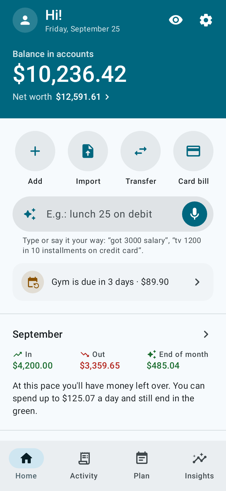
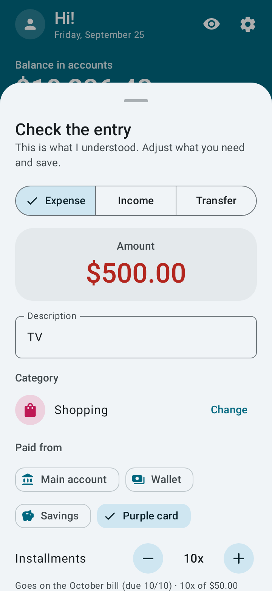
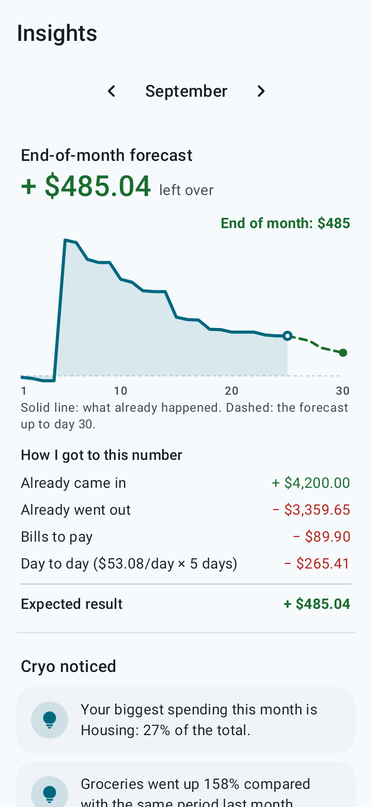
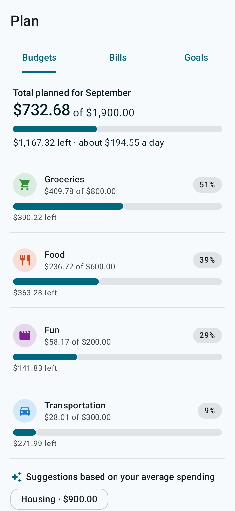
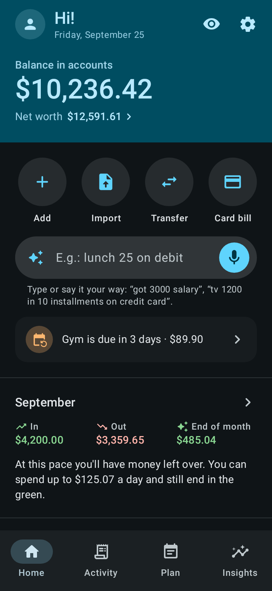

<p align="center">
  
</p>

<h1 align="center">Cryo</h1>

<p align="center"><b>Your money, crystal clear.</b><br>
A personal finance app for Android: simple to use, complete, offline and open source.</p>

<p align="center">
  <b>English</b> ·
  <a href="docs/readme/README.pt-BR.md">Português</a> ·
  <a href="docs/readme/README.es.md">Español</a> ·
  <a href="docs/readme/README.fr.md">Français</a> ·
  <a href="docs/readme/README.de.md">Deutsch</a> ·
  <a href="docs/readme/README.it.md">Italiano</a> ·
  <a href="docs/readme/README.ja.md">日本語</a> ·
  <a href="docs/readme/README.ko.md">한국어</a> ·
  <a href="docs/readme/README.zh-CN.md">中文</a> ·
  <a href="docs/readme/README.hi.md">हिन्दी</a>
</p>

<p align="center">
  
  
  
  
  
</p>

## What it does

- **Log by typing or speaking.** Type or say "lunch 12.50 on debit" or "tv 500 in 10 installments on credit card". Cryo understands the amount, the category, the account, the date and the installments. You just check and save.
- **End-of-month forecast.** See how much should be left at your current pace and how much you can spend per day.
- **Spending heatmap and money flow.** See which days you spend the most, where the money came from and where it went.
- **Import bank statements.** OFX, CSV, spreadsheet (XLSX) or PDF: you review the list before anything goes in, with suggested categories, what is already in Cryo unchecked and credit card bill payments recognized.
- **Credit cards.** Bills, available limit and installment purchases, each installment on the right bill.
- **Debts.** Loans, financing, agreements and money you owe someone, kept apart from the rest: how much is left, late installments, how much of your income goes to installments and when you will be debt-free.
- **Planning.** Recurring bills with reminders, a budget per category and savings goals with a suggested monthly amount.
- **Investments and transfers** between accounts.
- **10 languages and your currency.** English, Portuguese, Spanish, French, German, Italian, Japanese, Korean, Chinese and Hindi, in the currency you choose (dollar, euro, pound, yen, won, rupee, real and more). Logging by phrase and importing statements work in all of them.
- **A quick animated tour** shows how to use the app the first time you open it (and again whenever you want, in Settings).
- **Material You**, light and dark themes and smooth animations that follow your phone's "Remove animations" setting.

## Privacy

- Your data stays on your phone. **The app has no internet permission.**
- No sign-up, no ads, no tracking.
- Lock with fingerprint, face or your phone's screen lock.
- **Automatic backup** to a folder on your phone or to your cloud (Google Drive, Nextcloud and others), daily, weekly or monthly. Cryo writes the file through Android's file picker, and the cloud app is the one that uploads it.
- Backup to a `.json` file and export to a `.csv` spreadsheet, whenever you want.

Voice entry uses the speech recognition already installed on your phone. Typing the phrase always works.

## Install

- **F-Droid:** [f-droid.org/packages/io.github.h3yk0.cryo](https://f-droid.org/packages/io.github.h3yk0.cryo/)
- **GitHub:** download `Cryo-<version>.apk` from the [Releases](https://github.com/H3yK0/cryo/releases) page.

Both are the same file, signed with the same key: F-Droid builds the code again and only publishes it if the result is identical to the APK here (reproducible build). So you can update from either one without uninstalling.

## Build from source

Requirements: JDK 21 and the Android SDK (platform 36). The published APK is built with JDK 21, the same one F-Droid uses.

```bash
./gradlew assembleRelease     # unsigned APK in app/build/outputs/apk/release/
./gradlew testDebugUnitTest   # automated tests (rules, database, backup, import and screens)
```

To sign with your own key, create `keystore/keystore.properties` with `storeFile`, `storePassword`, `keyAlias` and `keyPassword`. The `keystore/` folder never goes into the repository.

To regenerate the screenshots of the F-Droid page and of these READMEs (`fastlane/` folder), in the 10 languages:

```bash
./gradlew testDebugUnitTest --tests '*StoreScreenshotsTest' --tests '*StoreAssetsTest' -PstoreAssets=true
```

### How the code is organized

| Folder | Contents |
|---|---|
| `domain/` | Rules without Android: balances, bills and installments, debts, forecast, money flow, the phrase interpreter (`PhraseParser.kt`, `PhraseLang.kt`), languages and currencies |
| `importer/` | Statement reading (OFX, CSV, XLSX, PDF and the test JSON) and the review before importing |
| `data/` | Database (Room), settings, backup, default categories and sample data |
| `ui/` | Screens in Jetpack Compose with Material 3 |
| `notify/` | Reminders for recurring bills and debt installments (WorkManager) |

The project documents (requirements in [docs/PRD.md](docs/PRD.md), visual guide, statement import) are written in Portuguese, the author's language.

## Contributing

Suggestions and bug reports are welcome in [Issues](https://github.com/H3yK0/cryo/issues), in any of the 10 languages.

- **Translations:** the 9 translations were made with the help of AI. If you speak one of these languages and find something odd, please open an issue: native review is very welcome.
- **Statements from your bank:** the app has a **developer mode** (tap the version 7 times in Settings › About) with a test mode that uses a separate database and sample data, sample statements in every format and a reading report that can be shared in an anonymous version. If your bank's statement is not read correctly, you can help without sending your data: see [docs/IMPORTACAO.md](docs/IMPORTACAO.md#ajudar-a-melhorar-a-leitura) (in Portuguese).

## License

Copyright © 2026 Hanry Franco

This program is free software: you can redistribute it and/or modify it under the terms of the [GNU Affero General Public License](LICENSE) as published by the Free Software Foundation, either version 3 of the License, or (at your option) any later version. Up to version 1.3, Cryo was distributed under the GNU General Public License v3 or later. It is distributed in the hope that it will be useful, but **without any warranty**.
