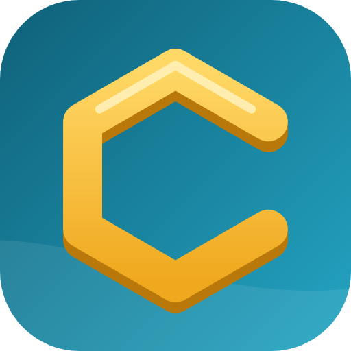
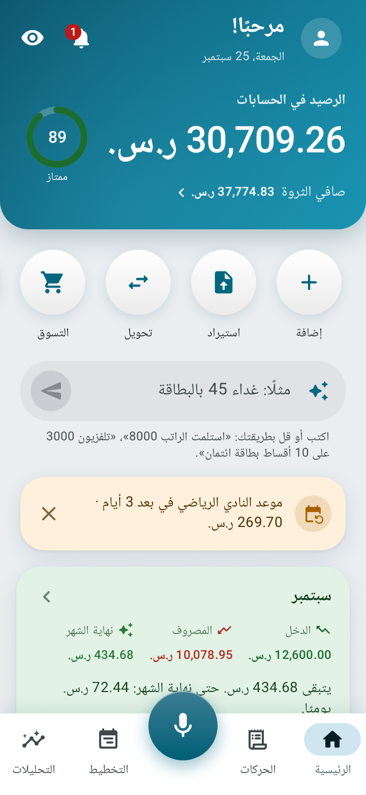
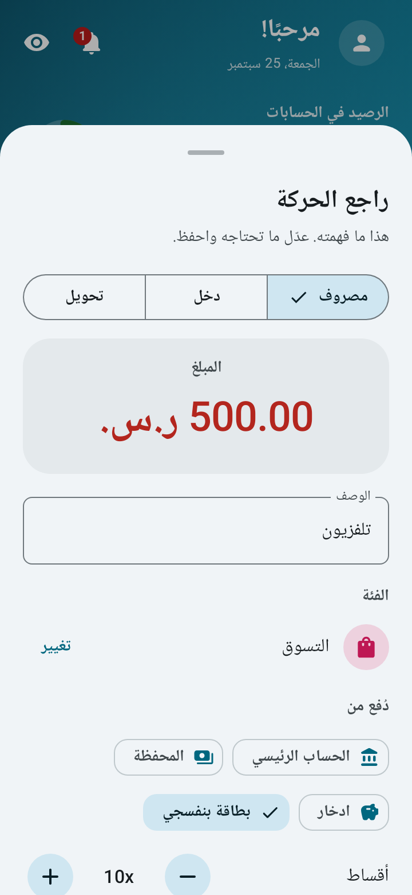
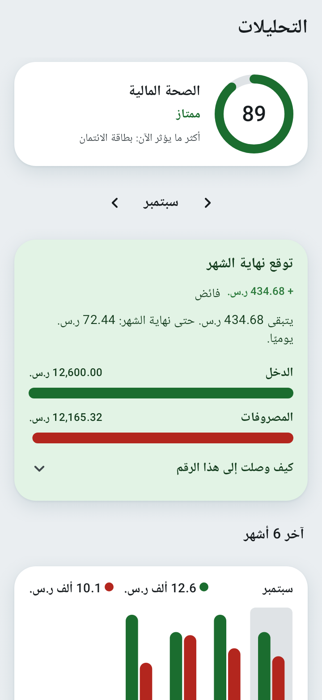
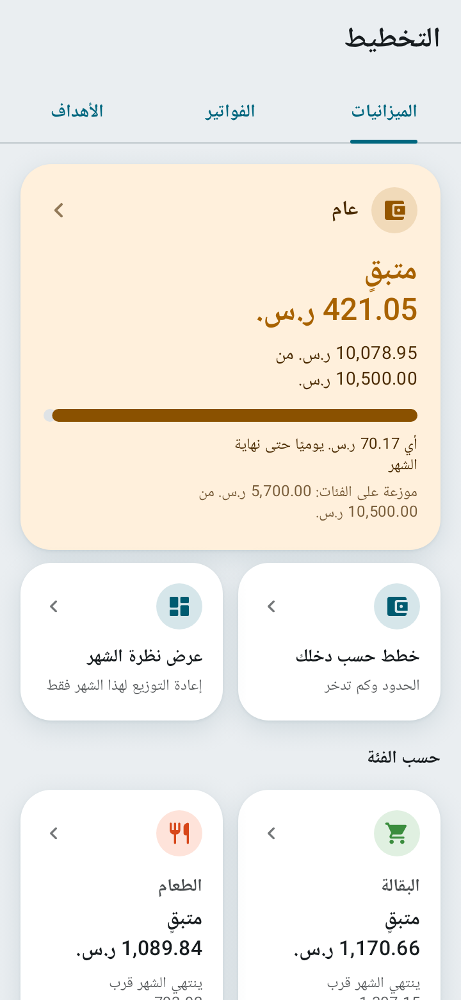
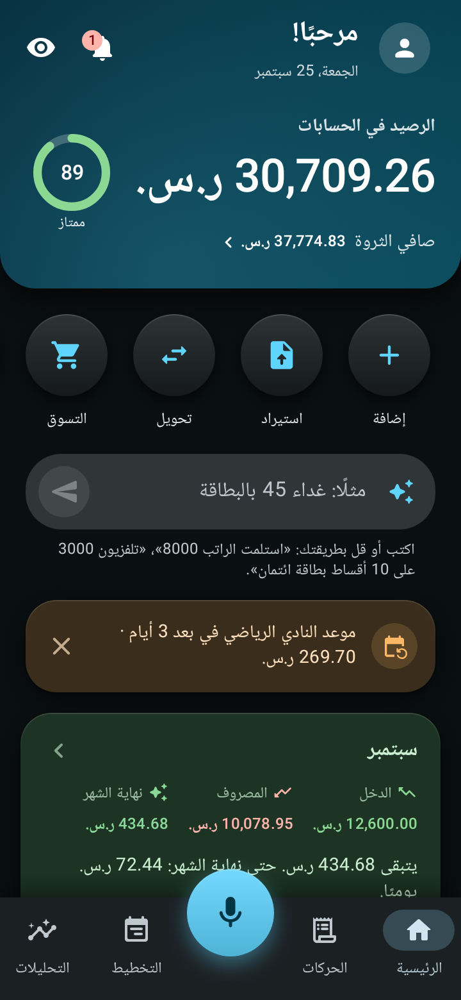

<p align="center">
  
</p>

<h1 align="center">Cryo</h1>

<p align="center" dir="rtl"><b>أموالك، صافية كالجليد.</b><br>
تطبيق للتمويل الشخصي على Android: سهل الاستخدام، كامل، يعمل دون إنترنت ومفتوح المصدر.</p>

<p align="center">
  <a href="../../README.md">English</a> ·
  <a href="README.pt-BR.md">Português</a> ·
  <a href="README.es.md">Español</a> ·
  <a href="README.fr.md">Français</a> ·
  <a href="README.de.md">Deutsch</a> ·
  <a href="README.it.md">Italiano</a> ·
  <a href="README.ja.md">日本語</a> ·
  <a href="README.ko.md">한국어</a> ·
  <a href="README.zh-CN.md">中文</a> ·
  <a href="README.hi.md">हिन्दी</a> ·
  <a href="README.ru.md">Русский</a> ·
  <a href="README.uk.md">Українська</a> ·
  <b>العربية</b> ·
  <a href="README.he.md">עברית</a>
</p>

<p align="center">
  
  
  
  
  
</p>

<div dir="rtl">

## ماذا يفعل

- **التسجيل بالكتابة أو بالصوت.** اكتب أو قل "غداء 45 بالبطاقة" أو "تلفزيون 3000 على 10 أقساط". يفهم Cryo المبلغ والفئة والحساب والتاريخ والأقساط. ما عليك إلا المراجعة والحفظ.
- **محرك مالي على هاتفك.** توقع نهاية الشهر يأتي مع نطاق مُختبَر على ماضيك، ورقمه هو دائمًا مجموع البنود التي تشرحه، ومنها فواتيرك وميزانياتك وما استثمرته. يكتشف Cryo راتبك وإيجارك واشتراكاتك وحده، ويجيب عن سؤال **"كيف سأنهي السنة؟"** بإشارات حمراء على الأيام التي تحتاج إلى انتباه، ويخبرك إن كانت **أهدافك تتسع** بالوتيرة الحالية، وينبهك إلى الرسوم غير المعتادة والمكررة، ويعرض درجة الصحة المالية (بجانب رصيدك)، والفوائد المخفية في ديونك مع خطة للسداد، والعائد السنوي الحقيقي لاستثماراتك. كل ذلك يُحسب دون إنترنت.
- **تقويم المصروفات وتدفق المال.** في أي الأيام تنفق أكثر بألوان الحرارة، ومن أين جاء المال وإلى أين ذهب بالأشرطة أو بالقمع. المس أي جزء لرؤية حركاته.
- **استيراد كشوف البنك.** OFX أو CSV أو جدول (XLSX) أو PDF: تراجع القائمة قبل أن يدخل أي شيء، مع فئات مقترحة؛ وما هو موجود في Cryo لا يُحدَّد، وتُعرف مدفوعات فواتير البطاقة.
- **بطاقات الائتمان.** الفواتير والحد المتاح والمشتريات بالتقسيط، وكل قسط في الفاتورة الصحيحة.
- **الديون.** القروض والتمويل والاتفاقات والمال الذي تدين به لأحد، منفصلة عن الباقي: كم تبقى، والأقساط المتأخرة، وكم من دخلك يذهب للأقساط، ومتى تتخلص من الديون.
- **التخطيط.** فواتير ثابتة (شهرية أو سنوية أو على أقساط) مع تذكير، والفواتير المتوقعة في الكشف وتخطي شهر، وميزانية لكل فئة — أو **حسب دخلك** — تنبهك حين لا تتسع فواتيرك، وأهداف ادخار.
- **كشف لكل حساب** مثل كشف البنك: كل عملية مع الرصيد بعدها والرصيد في آخر كل يوم. وفي الكشف العام تظهر لكل عملية حسابها، ويمكن التصفية حسب حساب واحد.
- **الاستثمارات والتحويلات** بين الحسابات.
- **14 لغة وعملتك.** الإنجليزية والبرتغالية والإسبانية والفرنسية والألمانية والإيطالية واليابانية والكورية والصينية والهندية والروسية والأوكرانية والعربية والعبرية (من اليمين إلى اليسار)، بالعملة التي تختارها (الريال والدرهم والجنيه والدولار واليورو والجنيه الإسترليني والين والوون والروبية والروبل والهريفنيا والشيكل وغيرها). التسجيل بالعبارات واستيراد الكشوف يعملان في كل اللغات، والعربية بالأرقام 0–9 كما في البنك ولوحة المفاتيح.
- **جولة متحركة قصيرة** تشرح استخدام التطبيق عند فتحه أول مرة (ومتى شئت من الإعدادات).
- **أداة على الشاشة الرئيسية** بالحجم الذي تريده وبما يهمك: نهاية الشهر، أو الرصيد في الحسابات، أو المتبقي من الميزانية العامة، أو صافي الثروة، مع الفواتير القادمة أو الميزانيات أو الأهداف وزر «إضافة».
- **شاشاتك كما تحب.** اسحب جانبًا لتبديل التبويب، ورتّب كل شاشة: المربعات بالترتيب الذي تفضله، مع إخفاء ما لا تستخدمه.
- **Material You**، وسمتان فاتحة وداكنة، وحركات سلسة تحترم إعداد "إزالة الرسوم المتحركة" في هاتفك.

## الخصوصية

- بياناتك تبقى على هاتفك. **لا يملك التطبيق إذن الوصول إلى الإنترنت.**
- بلا تسجيل وبلا إعلانات وبلا تتبع.
- قفل ببصمة الإصبع أو الوجه أو قفل شاشة الهاتف، من جديد فورًا أو بعد المدة التي تختارها، مع **وضع خصوصية** اختياري يجعل لقطات الشاشة وتسجيلها سوداء.
- **نسخ احتياطي تلقائي** إلى مجلد على هاتفك أو إلى سحابتك (Google Drive وNextcloud وغيرهما)، يوميًا أو أسبوعيًا أو شهريًا. يكتب Cryo الملف عبر منتقي الملفات في Android، وتطبيق السحابة هو الذي يرفعه.
- **نسخ احتياطية بكلمة مرور** (اختياري): تُشفَّر الملفات بـ AES-256 ولا تُقرأ دون كلمة مرورك. يبقى المفتاح في المخزن الآمن في Android.
- نسخ إلى ملف `.json` وتصدير إلى جدول `.csv` متى شئت.

**صوت يبقى على هاتفك.** يُفهم الصوت على الهاتف نفسه بواسطة Whisper (نموذج كلام مفتوح)؛ ولا يصبح التسجيل ملفًا أبدًا. يُنزَّل النموذج مرة واحدة من المتصفح — فلا يملك Cryo إذن الإنترنت — ولا يقبل Cryo إلا الملف الرسمي بعد التحقق من SHA-256 ([النماذج](../VOZ-MODELOS.md)). ومن دونه يُستخدم التعرف على الكلام في الهاتف نفسه. كتابة العبارة تعمل دائمًا.

## التثبيت

- **F-Droid:** [f-droid.org/packages/io.github.h3yk0.cryo](https://f-droid.org/packages/io.github.h3yk0.cryo/)
- **GitHub:** نزّل `Cryo-<الإصدار>.apk` من صفحة [Releases](https://github.com/H3yK0/cryo/releases).

هما الملف نفسه، موقَّعان بالمفتاح نفسه: يبني F-Droid الشيفرة من جديد ولا ينشرها إلا إن طابقت النتيجة ملف APK هنا (بناء قابل لإعادة الإنتاج). لذلك يمكنك التحديث من أي منهما دون إلغاء التثبيت.

## البناء من المصدر

المتطلبات: JDK 21 وAndroid SDK (المنصة 36). يُبنى ملف APK المنشور بـ JDK 21، وهو نفسه الذي يستخدمه F-Droid.

```bash
./gradlew assembleRelease     # APK غير موقَّع في app/build/outputs/apk/release/
./gradlew testDebugUnitTest   # الاختبارات الآلية (القواعد وقاعدة البيانات والنسخ والاستيراد والشاشات)
```

للتوقيع بمفتاحك، أنشئ `keystore/keystore.properties` فيه `storeFile` و`storePassword` و`keyAlias` و`keyPassword`. لا يدخل مجلد `keystore/` المستودع أبدًا.

لإعادة إنشاء صور شاشات صفحة F-Droid وهذه الملفات README (مجلد `fastlane/`) باللغات الـ 14:

```bash
./gradlew testDebugUnitTest --tests '*StoreScreenshotsTest' --tests '*StoreAssetsTest' -PstoreAssets=true
```

### كيف نُظِّمت الشيفرة

| المجلد | المحتوى |
|---|---|
| `domain/` | قواعد بلا Android: الأرصدة والفواتير والأقساط والديون والتوقع وتدفق المال ومفسر العبارات (`PhraseParser.kt` و`PhraseLang.kt`) واللغات والعملات |
| `importer/` | قراءة الكشوف (OFX وCSV وXLSX وPDF وملف JSON التجريبي) والمراجعة قبل الاستيراد |
| `data/` | قاعدة البيانات (Room) والإعدادات والنسخ الاحتياطي والفئات الافتراضية والبيانات التجريبية |
| `ui/` | الشاشات بـ Jetpack Compose مع Material 3 |
| `notify/` | تذكير الفواتير الثابتة وأقساط الديون (WorkManager) |

وثائق المشروع (المتطلبات في [docs/PRD.md](../PRD.md)، والدليل المرئي، واستيراد الكشوف) مكتوبة بالبرتغالية، لغة المؤلف.

## المساهمة

الاقتراحات وبلاغات الأخطاء مرحب بها في [Issues](https://github.com/H3yK0/cryo/issues)، بأي من اللغات الـ 14.

- **الترجمات:** أُنجزت الترجمات الـ 13 بمساعدة الذكاء الاصطناعي. إن كنت تتحدث إحدى هذه اللغات ووجدت شيئًا غريبًا، فافتح issue: مراجعة المتحدثين الأصليين مرحب بها جدًا.
- **كشوف بنكك:** في التطبيق **وضع المطوّر** (اضغط على الإصدار 7 مرات في الإعدادات › حول) مع وضع تجريبي بقاعدة بيانات منفصلة وبيانات تجريبية، وكشوف تجريبية بكل الصيغ، وتقرير قراءة يمكن مشاركته بنسخة مجهولة. إن لم يُقرأ كشف بنكك جيدًا، يمكنك المساعدة دون إرسال بياناتك: انظر [docs/IMPORTACAO.md](../IMPORTACAO.md#ajudar-a-melhorar-a-leitura) (بالبرتغالية).

## الدعم

Cryo مجاني، بلا إعلانات ولا تتبع ولا وصول إلى الإنترنت. إن كان يفيدك وأحببت أن تدعو المؤلف إلى فنجان قهوة، فذلك مرحب به جدًا — واختياري تمامًا.

<a href="https://www.buymeacoffee.com/H3YK0" target="_blank"></a>

## الترخيص

Copyright © 2026 Hanry Franco

هذا البرنامج حر: يمكنك إعادة توزيعه و/أو تعديله وفق شروط [GNU Affero General Public License](../../LICENSE) كما نشرتها Free Software Foundation، الإصدار 3 أو (حسب اختيارك) أي إصدار لاحق. حتى الإصدار 1.3 كان Cryo يُوزَّع وفق GNU General Public License الإصدار 3 أو أحدث. يُوزَّع على أمل أن يكون مفيدًا، لكن **دون أي ضمان**.

</div>
