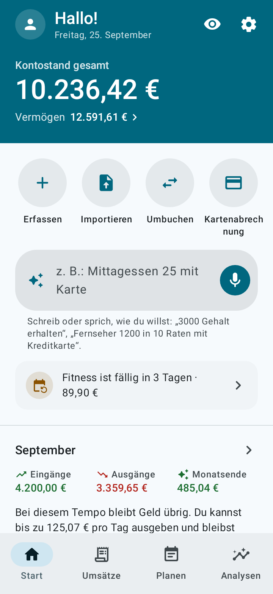
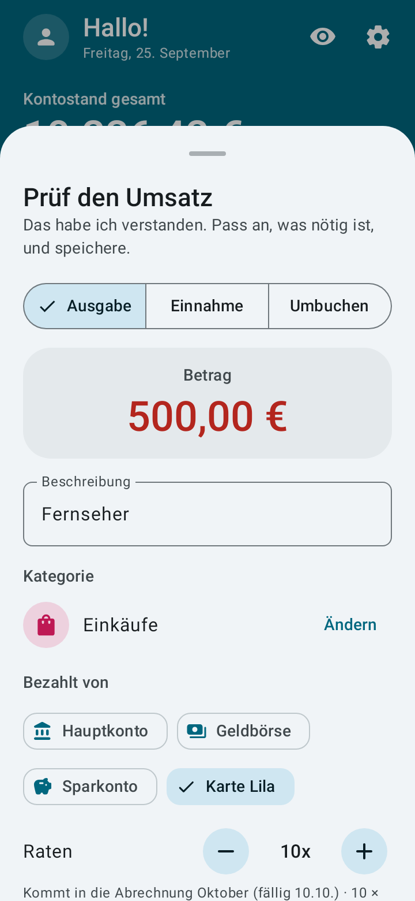
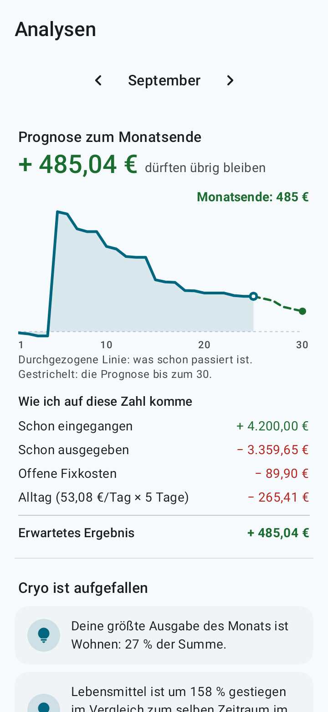
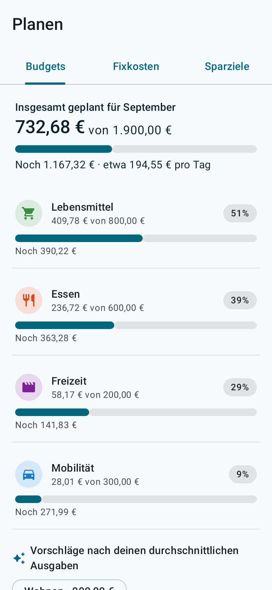
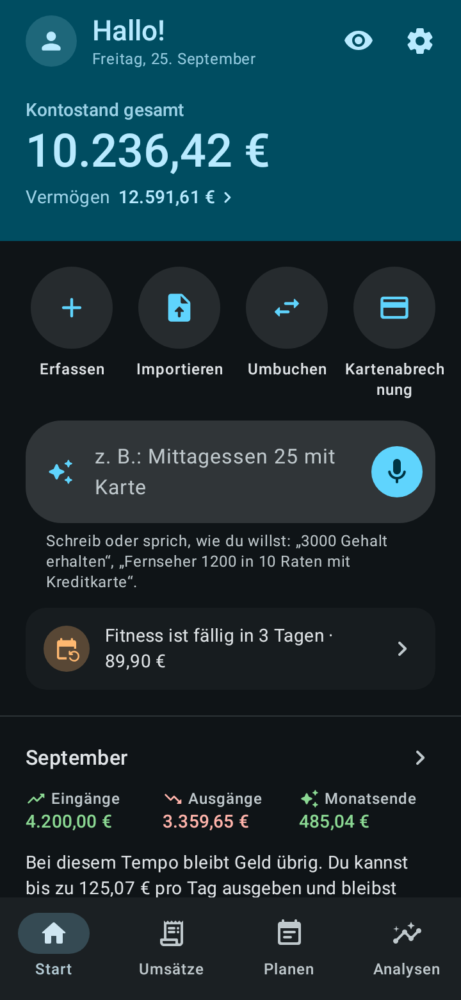

<p align="center">
  
</p>

<h1 align="center">Cryo</h1>

<p align="center"><b>Dein Geld, klar wie Eis.</b><br>
Android-App für persönliche Finanzen: einfach, vollständig, offline und quelloffen.</p>

<p align="center">
  <a href="../../README.md">English</a> ·
  <a href="README.pt-BR.md">Português</a> ·
  <a href="README.es.md">Español</a> ·
  <a href="README.fr.md">Français</a> ·
  <b>Deutsch</b> ·
  <a href="README.it.md">Italiano</a> ·
  <a href="README.ja.md">日本語</a> ·
  <a href="README.ko.md">한국어</a> ·
  <a href="README.zh-CN.md">中文</a> ·
  <a href="README.hi.md">हिन्दी</a>
</p>

<p align="center">
  
  
  
  
  
</p>

## Was sie kann

- **Erfassen per Satz oder Sprache.** Schreib oder sag „Mittagessen 12,50 mit Karte“ oder „Fernseher 500 in 10 Raten mit Kreditkarte“. Cryo versteht Betrag, Kategorie, Konto, Datum und Raten. Du prüfst nur noch und speicherst.
- **Prognose zum Monatsende.** Sieh, wie viel bei deinem Tempo übrig bleiben sollte und wie viel du pro Tag ausgeben kannst.
- **Ausgaben-Heatmap und Geldfluss.** Sieh, an welchen Tagen du am meisten ausgibst, woher das Geld kam und wohin es ging.
- **Kontoauszüge importieren.** OFX, CSV, Tabelle (XLSX) oder PDF: Du prüfst die Liste, bevor etwas übernommen wird, mit vorgeschlagenen Kategorien, schon Vorhandenem abgewählt und erkannter Kreditkartenzahlung.
- **Kreditkarten.** Abrechnungen, verfügbares Limit und Ratenkäufe, jede Rate in der richtigen Abrechnung.
- **Schulden.** Kredite, Finanzierungen, Vereinbarungen und Geld, das du jemandem schuldest, getrennt vom Rest: wie viel noch fehlt, überfällige Raten, wie viel deines Einkommens in Raten geht und wann du schuldenfrei bist.
- **Planung.** Fixkosten mit Erinnerung, Budget pro Kategorie und Sparziele mit vorgeschlagenem Monatsbetrag.
- **Geldanlagen und Überweisungen** zwischen Konten.
- **10 Sprachen und deine Währung.** Deutsch, Englisch, Portugiesisch, Spanisch, Französisch, Italienisch, Japanisch, Koreanisch, Chinesisch und Hindi, in der Währung deiner Wahl (Euro, Franken, Dollar, Pfund, Yen, Won, Rupie, Real und mehr). Erfassen per Satz und der Import von Kontoauszügen funktionieren in allen.
- **Eine kurze animierte Tour** zeigt beim ersten Öffnen, wie die App funktioniert (und wieder, wann du willst, in den Einstellungen).
- **Material You**, helles und dunkles Design und flüssige Animationen, die der Handy-Option „Animationen entfernen“ folgen.

## Datenschutz

- Deine Daten bleiben auf deinem Handy. **Die App hat keine Internetberechtigung.**
- Keine Anmeldung, keine Werbung, kein Tracking.
- Sperre per Fingerabdruck, Gesicht oder Displaysperre des Handys.
- **Automatische Sicherung** in einem Ordner auf dem Handy oder in deiner Cloud (Google Drive, Nextcloud und andere), täglich, wöchentlich oder monatlich. Cryo schreibt die Datei über die Dateiauswahl von Android, und die Cloud-App lädt sie hoch.
- Sicherung in eine `.json`-Datei und Export als `.csv`-Tabelle, wann du willst.

Die Spracheingabe nutzt die Spracherkennung, die schon auf deinem Handy installiert ist. Den Satz zu tippen funktioniert immer.

## Installation

- **F-Droid:** [f-droid.org/packages/io.github.h3yk0.cryo](https://f-droid.org/packages/io.github.h3yk0.cryo/)
- **GitHub:** lade `Cryo-<Version>.apk` auf der Seite [Releases](https://github.com/H3yK0/cryo/releases) herunter.

Beides ist dieselbe Datei, mit demselben Schlüssel signiert: F-Droid kompiliert den Code neu und veröffentlicht ihn nur, wenn das Ergebnis mit der APK hier identisch ist (reproduzierbarer Build). So kannst du über beide Wege aktualisieren, ohne zu deinstallieren.

## Aus dem Quellcode bauen

Voraussetzungen: JDK 21 und das Android SDK (Plattform 36). Die veröffentlichte APK wird mit JDK 21 gebaut, demselben wie bei F-Droid.

```bash
./gradlew assembleRelease     # unsignierte APK in app/build/outputs/apk/release/
./gradlew testDebugUnitTest   # automatische Tests (Regeln, Datenbank, Sicherung, Import und Bildschirme)
```

Um mit deinem eigenen Schlüssel zu signieren, lege `keystore/keystore.properties` mit `storeFile`, `storePassword`, `keyAlias` und `keyPassword` an. Der Ordner `keystore/` kommt nie ins Repository.

Um die Bildschirmfotos der F-Droid-Seite und dieser READMEs (Ordner `fastlane/`) in den 10 Sprachen neu zu erzeugen:

```bash
./gradlew testDebugUnitTest --tests '*StoreScreenshotsTest' --tests '*StoreAssetsTest' -PstoreAssets=true
```

### Wie der Code aufgebaut ist

| Ordner | Inhalt |
|---|---|
| `domain/` | Regeln ohne Android: Salden, Abrechnungen und Raten, Schulden, Prognose, Geldfluss, der Satz-Interpreter (`PhraseParser.kt`, `PhraseLang.kt`), Sprachen und Währungen |
| `importer/` | Einlesen von Kontoauszügen (OFX, CSV, XLSX, PDF und das Test-JSON) und die Prüfung vor dem Import |
| `data/` | Datenbank (Room), Einstellungen, Sicherung, Standardkategorien und Beispieldaten |
| `ui/` | Bildschirme in Jetpack Compose mit Material 3 |
| `notify/` | Erinnerungen an Fixkosten und Schuldenraten (WorkManager) |

Die Projektdokumente (Anforderungen in [docs/PRD.md](../PRD.md), visueller Leitfaden, Import von Kontoauszügen) sind auf Portugiesisch, der Sprache des Autors.

## Mitmachen

Vorschläge und Fehlermeldungen sind unter [Issues](https://github.com/H3yK0/cryo/issues) willkommen, in jeder der 10 Sprachen.

- **Übersetzungen:** Die 9 Übersetzungen entstanden mit Hilfe von KI. Wenn du eine dieser Sprachen sprichst und dir etwas seltsam vorkommt, eröffne bitte ein Issue: Durchsicht durch Muttersprachler ist sehr willkommen.
- **Der Kontoauszug deiner Bank:** Die App hat einen **Entwicklermodus** (7-mal auf die Version tippen, unter Einstellungen › Über) mit einem Testmodus, der eine eigene Datenbank und Beispieldaten nutzt, Beispielauszüge in allen Formaten und einen Lesebericht, der in anonymer Fassung geteilt werden kann. Wird der Auszug deiner Bank nicht richtig gelesen, kannst du helfen, ohne deine Daten zu schicken: siehe [docs/IMPORTACAO.md](../IMPORTACAO.md#ajudar-a-melhorar-a-leitura) (auf Portugiesisch).

## Lizenz

Copyright © 2026 Hanry Franco

Dieses Programm ist freie Software: Du kannst es unter den Bedingungen der [GNU Affero General Public License](../../LICENSE), wie von der Free Software Foundation veröffentlicht, weitergeben und/oder ändern, entweder gemäß Version 3 der Lizenz oder (nach deiner Wahl) jeder späteren Version. Bis Version 1.3 wurde Cryo unter der GNU General Public License v3 oder später verbreitet. Es wird in der Hoffnung verbreitet, dass es nützlich ist, aber **ohne jede Gewährleistung**. Maßgeblich ist der englische Originaltext der Lizenz.
