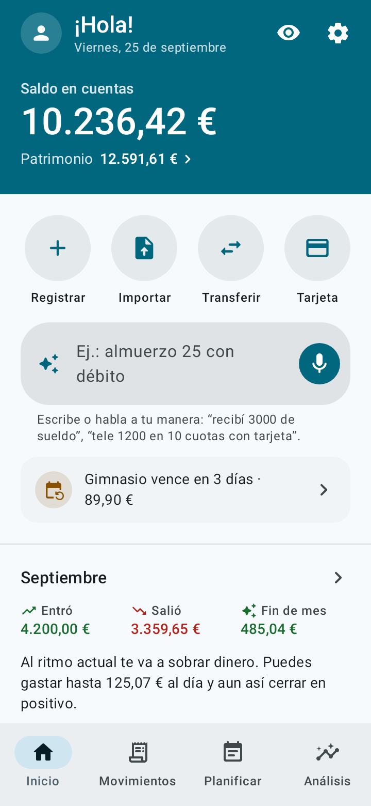
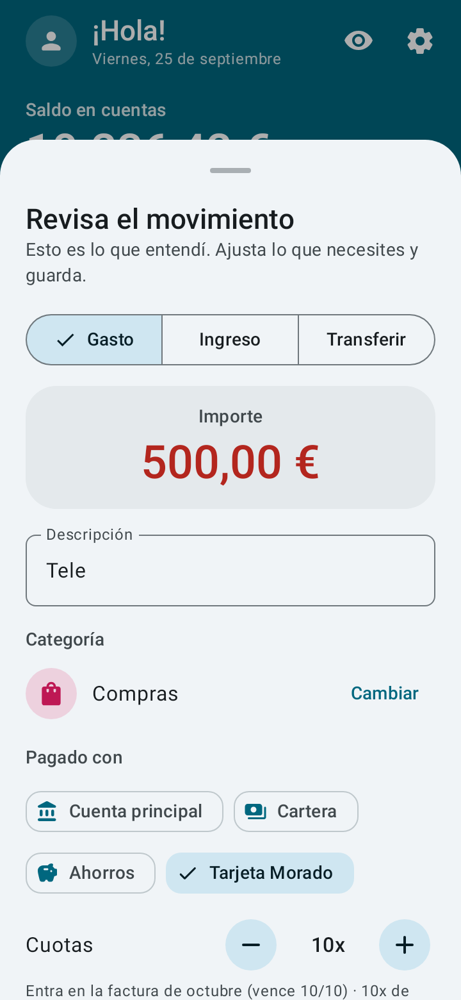
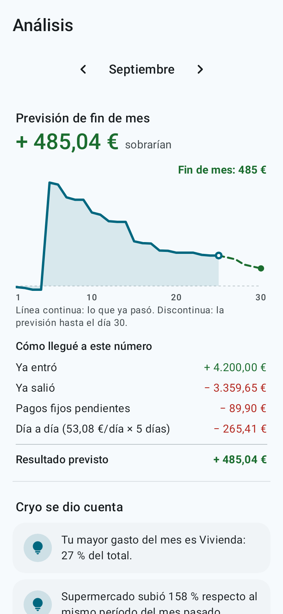
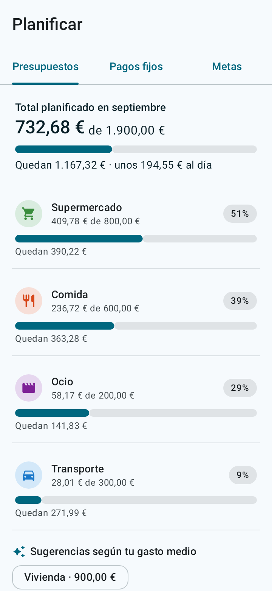
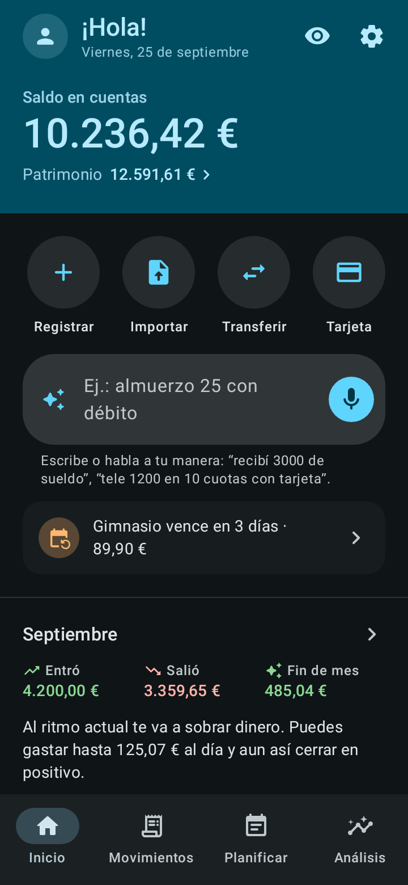

<p align="center">
  
</p>

<h1 align="center">Cryo</h1>

<p align="center"><b>Tu dinero, claro como el hielo.</b><br>
App de finanzas personales para Android: fácil de usar, completa, sin conexión y de código abierto.</p>

<p align="center">
  <a href="../../README.md">English</a> ·
  <a href="README.pt-BR.md">Português</a> ·
  <b>Español</b> ·
  <a href="README.fr.md">Français</a> ·
  <a href="README.de.md">Deutsch</a> ·
  <a href="README.it.md">Italiano</a> ·
  <a href="README.ja.md">日本語</a> ·
  <a href="README.ko.md">한국어</a> ·
  <a href="README.zh-CN.md">中文</a> ·
  <a href="README.hi.md">हिन्दी</a>
</p>

<p align="center">
  
  
  
  
  
</p>

## Qué hace

- **Registro por frase o voz.** Escribe o di "almuerzo 12,50 con débito" o "tele 500 en 10 cuotas con tarjeta". Cryo entiende el monto, la categoría, la cuenta, la fecha y las cuotas. Tú solo revisas y guardas.
- **Previsión de fin de mes.** Muestra cuánto debería sobrar al ritmo actual y cuánto puedes gastar por día.
- **Calendario de calor y flujo del dinero.** Mira qué días gastas más, de dónde vino el dinero y a dónde fue.
- **Importar extractos del banco.** OFX, CSV, hoja de cálculo (XLSX) o PDF: revisas la lista antes de que entre, con categorías sugeridas, lo que ya está en Cryo desmarcado y el pago de la tarjeta reconocido.
- **Tarjetas de crédito.** Facturas, límite disponible y compras en cuotas, cada cuota en la factura correcta.
- **Deudas.** Préstamos, financiaciones, acuerdos y dinero que le debes a alguien, separados del resto: cuánto falta, cuotas atrasadas, qué parte de tus ingresos va a cuotas y cuándo quedas libre.
- **Planificación.** Pagos fijos con recordatorio, presupuesto por categoría y metas con un monto mensual sugerido.
- **Inversiones y transferencias** entre cuentas.
- **10 idiomas y tu moneda.** Español, inglés, portugués, francés, alemán, italiano, japonés, coreano, chino e hindi, en la moneda que elijas (euro, peso, dólar, libra, yen, won, rupia, real y más). El registro por frase y la importación de extractos funcionan en todos.
- **Un recorrido animado** muestra cómo usar la app la primera vez que la abres (y de nuevo cuando quieras, en Ajustes).
- **Material You**, tema claro y oscuro y animaciones suaves que siguen la opción "Quitar animaciones" del móvil.

## Privacidad

- Los datos se quedan solo en tu móvil. **La app no tiene permiso de internet.**
- Sin registro, sin anuncios y sin rastreo.
- Bloqueo con huella, rostro o el bloqueo de pantalla del móvil.
- **Copia de seguridad automática** en una carpeta del móvil o en tu nube (Google Drive, Nextcloud y otras), cada día, cada semana o cada mes. Cryo guarda el archivo con el selector de archivos de Android, y es la app de la nube la que lo sube.
- Copia en un archivo `.json` y exportación a una hoja `.csv`, cuando quieras.

El registro por voz usa el reconocimiento de voz que ya está instalado en tu móvil. Escribir la frase siempre funciona.

## Instalación

- **F-Droid:** [f-droid.org/packages/io.github.h3yk0.cryo](https://f-droid.org/packages/io.github.h3yk0.cryo/)
- **GitHub:** descarga `Cryo-<versión>.apk` en la página de [Releases](https://github.com/H3yK0/cryo/releases).

Los dos son el mismo archivo, firmado con la misma clave: F-Droid vuelve a compilar el código y solo lo publica si el resultado es idéntico al APK de aquí (compilación reproducible). Así puedes actualizar desde cualquiera de los dos sin desinstalar.

## Compilar desde el código

Requisitos: JDK 21 y el Android SDK (plataforma 36). El APK publicado se compila con JDK 21, el mismo que usa F-Droid.

```bash
./gradlew assembleRelease     # APK sin firmar en app/build/outputs/apk/release/
./gradlew testDebugUnitTest   # pruebas automáticas (reglas, base de datos, copias, importación y pantallas)
```

Para firmar con tu propia clave, crea `keystore/keystore.properties` con `storeFile`, `storePassword`, `keyAlias` y `keyPassword`. La carpeta `keystore/` nunca va al repositorio.

Para volver a generar las capturas de la página de F-Droid y de estos README (carpeta `fastlane/`), en los 10 idiomas:

```bash
./gradlew testDebugUnitTest --tests '*StoreScreenshotsTest' --tests '*StoreAssetsTest' -PstoreAssets=true
```

### Cómo está organizado el código

| Carpeta | Contenido |
|---|---|
| `domain/` | Reglas sin Android: saldos, facturas y cuotas, deudas, previsión, flujo del dinero, el intérprete de frases (`PhraseParser.kt`, `PhraseLang.kt`), idiomas y monedas |
| `importer/` | Lectura de extractos (OFX, CSV, XLSX, PDF y el JSON de prueba) y la revisión antes de importar |
| `data/` | Base de datos (Room), ajustes, copias de seguridad, categorías predeterminadas y datos de ejemplo |
| `ui/` | Pantallas en Jetpack Compose con Material 3 |
| `notify/` | Recordatorios de pagos fijos y cuotas de deudas (WorkManager) |

Los documentos del proyecto (requisitos en [docs/PRD.md](../PRD.md), guía visual, importación de extractos) están escritos en portugués, el idioma del autor.

## Contribuir

Las sugerencias y los reportes de errores son bienvenidos en [Issues](https://github.com/H3yK0/cryo/issues), en cualquiera de los 10 idiomas.

- **Traducciones:** las 9 traducciones se hicieron con ayuda de IA. Si hablas uno de estos idiomas y algo te suena raro, abre un issue: la revisión de hablantes nativos es muy bienvenida.
- **El extracto de tu banco:** la app tiene un **modo desarrollador** (toca la versión 7 veces en Ajustes › Acerca de) con un modo de prueba que usa una base de datos aparte y datos de ejemplo, extractos de ejemplo en todos los formatos y un informe de lectura que se puede compartir en versión anónima. Si el extracto de tu banco no se lee bien, puedes ayudar sin enviar tus datos: mira [docs/IMPORTACAO.md](../IMPORTACAO.md#ajudar-a-melhorar-a-leitura) (en portugués).

## Licencia

Copyright © 2026 Hanry Franco

Este programa es software libre: puedes redistribuirlo y/o modificarlo según los términos de la [GNU Affero General Public License](../../LICENSE) publicada por la Free Software Foundation, ya sea la versión 3 de la licencia o (a tu elección) cualquier versión posterior. Hasta la versión 1.3, Cryo se distribuyó bajo la GNU General Public License v3 o posterior. Se distribuye con la esperanza de que sea útil, pero **sin ninguna garantía**. El texto oficial de la licencia es el original en inglés.
