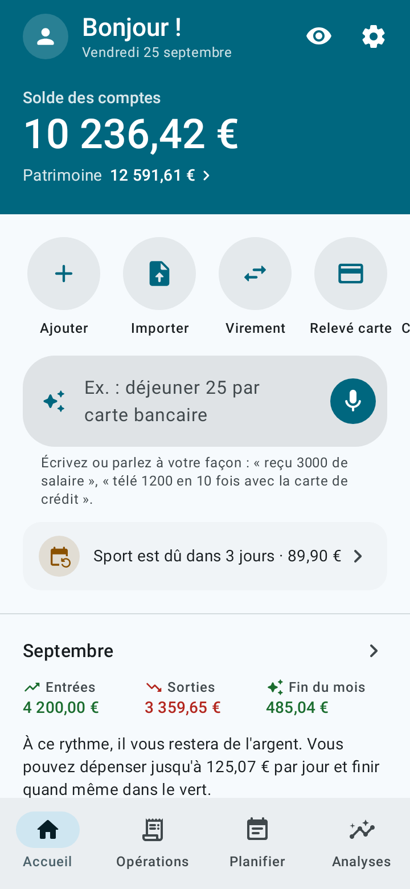
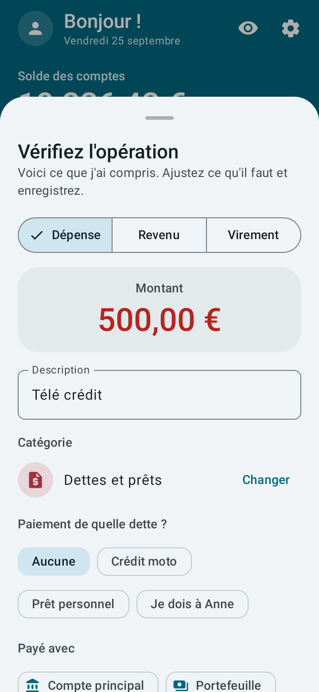
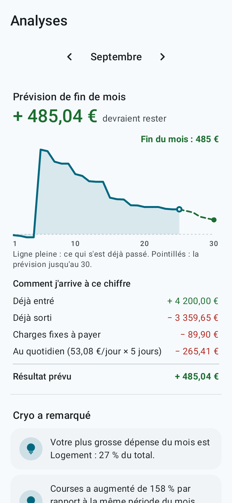
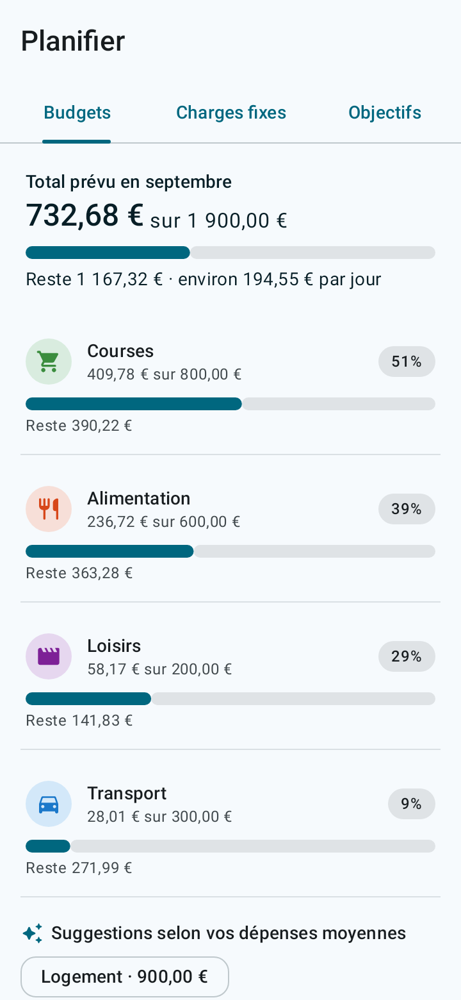
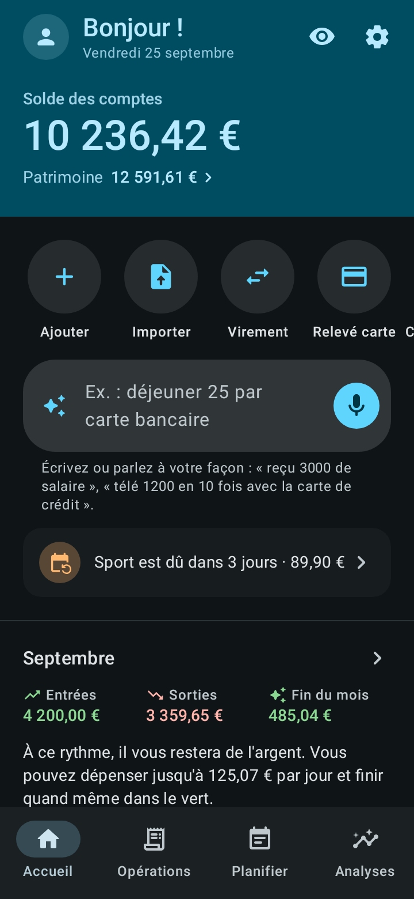

<p align="center">
  
</p>

<h1 align="center">Cryo</h1>

<p align="center"><b>Votre argent, clair comme de la glace.</b><br>
Application Android de finances personnelles : simple, complète, hors ligne et open source.</p>

<p align="center">
  <a href="../../README.md">English</a> ·
  <a href="README.pt-BR.md">Português</a> ·
  <a href="README.es.md">Español</a> ·
  <b>Français</b> ·
  <a href="README.de.md">Deutsch</a> ·
  <a href="README.it.md">Italiano</a> ·
  <a href="README.ja.md">日本語</a> ·
  <a href="README.ko.md">한국어</a> ·
  <a href="README.zh-CN.md">中文</a> ·
  <a href="README.hi.md">हिन्दी</a>
</p>

<p align="center">
  
  
  
  
  
</p>

## Ce qu'elle fait

- **Saisie par phrase ou à la voix.** Écrivez ou dites « déjeuner 12,50 par carte bancaire » ou « télé 500 en 10 fois avec la carte de crédit ». Cryo comprend le montant, la catégorie, le compte, la date et les échéances. Vous n'avez qu'à vérifier et enregistrer.
- **Prévision de fin de mois.** Voyez ce qu'il devrait rester à votre rythme actuel et combien vous pouvez dépenser par jour.
- **Calendrier de chaleur et flux de l'argent.** Voyez les jours où vous dépensez le plus, d'où vient l'argent et où il est allé.
- **Import de relevés bancaires.** OFX, CSV, tableur (XLSX) ou PDF : vous vérifiez la liste avant qu'elle n'entre, avec des catégories suggérées, ce qui est déjà dans Cryo décoché et le paiement de la carte reconnu.
- **Cartes de crédit.** Relevés, plafond disponible et achats en plusieurs fois, chaque échéance sur le bon relevé.
- **Dettes.** Prêts, crédits, accords et argent que vous devez à quelqu'un, à part du reste : ce qu'il reste, les échéances en retard, la part de vos revenus qui part en remboursements et quand vous serez libre.
- **Planification.** Charges fixes avec rappel, budget par catégorie et objectifs d'épargne avec un montant mensuel suggéré.
- **Investissements et virements** entre comptes.
- **10 langues et votre monnaie.** Français, anglais, portugais, espagnol, allemand, italien, japonais, coréen, chinois et hindi, dans la monnaie de votre choix (euro, franc suisse, dollar, livre, yen, won, roupie, real et d'autres). La saisie par phrase et l'import de relevés fonctionnent dans toutes.
- **Une visite animée** montre comment utiliser l'app à la première ouverture (et à nouveau quand vous voulez, dans les Réglages).
- **Material You**, thème clair et sombre et animations fluides qui respectent l'option « Supprimer les animations » du téléphone.

## Confidentialité

- Vos données restent sur votre téléphone. **L'app n'a pas l'autorisation d'accès à internet.**
- Sans inscription, sans publicité et sans pistage.
- Verrouillage par empreinte, visage ou verrouillage d'écran du téléphone.
- **Sauvegarde automatique** dans un dossier du téléphone ou dans votre cloud (Google Drive, Nextcloud et d'autres), chaque jour, chaque semaine ou chaque mois. Cryo écrit le fichier via le sélecteur de fichiers d'Android, et c'est l'app du cloud qui l'envoie.
- Sauvegarde dans un fichier `.json` et export vers un tableur `.csv`, quand vous voulez.

La saisie à la voix utilise la reconnaissance vocale déjà installée sur votre téléphone. Écrire la phrase fonctionne toujours.

## Installation

- **F-Droid:** [f-droid.org/packages/io.github.h3yk0.cryo](https://f-droid.org/packages/io.github.h3yk0.cryo/)
- **GitHub:** téléchargez `Cryo-<version>.apk` sur la page [Releases](https://github.com/H3yK0/cryo/releases).

Les deux sont le même fichier, signé avec la même clé : F-Droid recompile le code et ne le publie que si le résultat est identique à l'APK d'ici (compilation reproductible). Vous pouvez donc mettre à jour depuis l'un ou l'autre sans désinstaller.

## Compiler depuis le code

Prérequis : JDK 21 et le SDK Android (plateforme 36). L'APK publié est compilé avec le JDK 21, le même que celui de F-Droid.

```bash
./gradlew assembleRelease     # APK non signé dans app/build/outputs/apk/release/
./gradlew testDebugUnitTest   # tests automatiques (règles, base de données, sauvegarde, import et écrans)
```

Pour signer avec votre propre clé, créez `keystore/keystore.properties` avec `storeFile`, `storePassword`, `keyAlias` et `keyPassword`. Le dossier `keystore/` ne va jamais dans le dépôt.

Pour régénérer les captures de la page F-Droid et de ces README (dossier `fastlane/`), dans les 10 langues :

```bash
./gradlew testDebugUnitTest --tests '*StoreScreenshotsTest' --tests '*StoreAssetsTest' -PstoreAssets=true
```

### Organisation du code

| Dossier | Contenu |
|---|---|
| `domain/` | Règles sans Android : soldes, relevés et échéances, dettes, prévision, flux de l'argent, l'interpréteur de phrases (`PhraseParser.kt`, `PhraseLang.kt`), langues et monnaies |
| `importer/` | Lecture des relevés (OFX, CSV, XLSX, PDF et le JSON de test) et la vérification avant l'import |
| `data/` | Base de données (Room), réglages, sauvegarde, catégories par défaut et données d'exemple |
| `ui/` | Écrans en Jetpack Compose avec Material 3 |
| `notify/` | Rappels des charges fixes et des échéances de dettes (WorkManager) |

Les documents du projet (exigences dans [docs/PRD.md](../PRD.md), guide visuel, import de relevés) sont écrits en portugais, la langue de l'auteur.

## Contribuer

Les suggestions et les signalements de bugs sont les bienvenus dans [Issues](https://github.com/H3yK0/cryo/issues), dans n'importe laquelle des 10 langues.

- **Traductions :** les 9 traductions ont été faites avec l'aide de l'IA. Si vous parlez l'une de ces langues et que quelque chose sonne faux, ouvrez une issue : la relecture par des locuteurs natifs est très appréciée.
- **Le relevé de votre banque :** l'app a un **mode développeur** (touchez 7 fois la version dans Réglages › À propos) avec un mode test qui utilise une base de données séparée et des données d'exemple, des relevés d'exemple dans tous les formats et un rapport de lecture partageable en version anonyme. Si le relevé de votre banque n'est pas bien lu, vous pouvez aider sans envoyer vos données : voir [docs/IMPORTACAO.md](../IMPORTACAO.md#ajudar-a-melhorar-a-leitura) (en portugais).

## Licence

Copyright © 2026 Hanry Franco

Ce programme est un logiciel libre : vous pouvez le redistribuer et/ou le modifier selon les termes de la [GNU Affero General Public License](../../LICENSE) publiée par la Free Software Foundation, soit la version 3 de la licence, soit (à votre choix) toute version ultérieure. Jusqu'à la version 1.3, Cryo était distribué sous la GNU General Public License v3 ou ultérieure. Il est distribué dans l'espoir d'être utile, mais **sans aucune garantie**. Le texte officiel de la licence est l'original en anglais.
