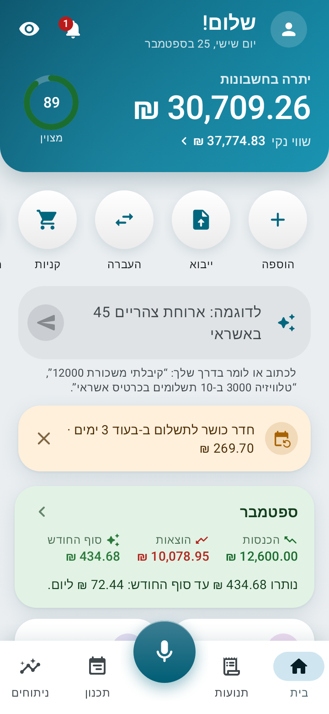
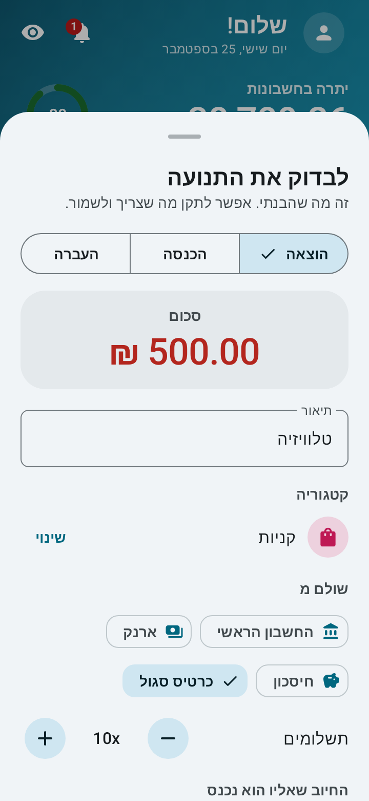
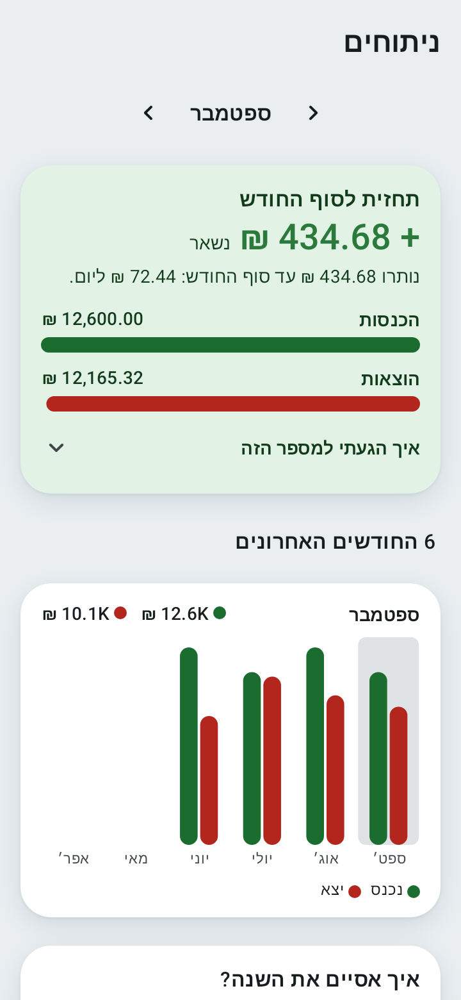
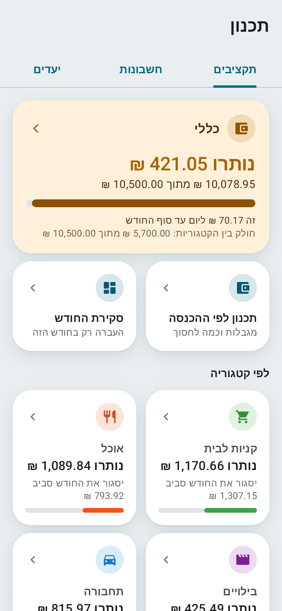
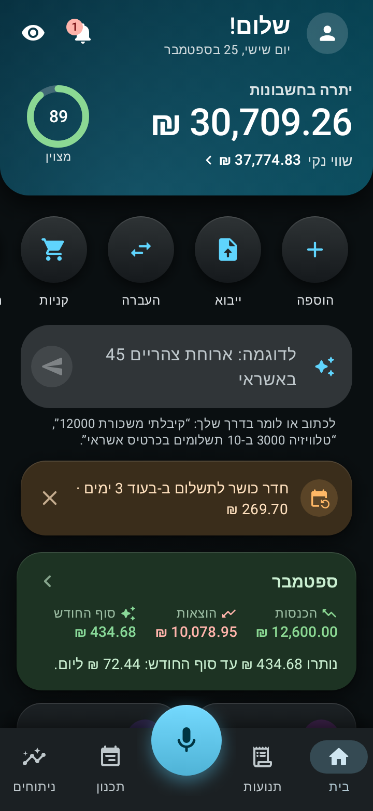

<p align="center">
  
</p>

<h1 align="center">Cryo</h1>

<p align="center" dir="rtl"><b>הכסף שלך, צלול כמו קרח.</b><br>
אפליקציה לניהול כספים אישי ל-Android: פשוטה, מלאה, בלי אינטרנט ובקוד פתוח.</p>

<p align="center">
  <a href="../../README.md">English</a> ·
  <a href="README.pt-BR.md">Português</a> ·
  <a href="README.es.md">Español</a> ·
  <a href="README.fr.md">Français</a> ·
  <a href="README.de.md">Deutsch</a> ·
  <a href="README.it.md">Italiano</a> ·
  <a href="README.ja.md">日本語</a> ·
  <a href="README.ko.md">한국어</a> ·
  <a href="README.zh-CN.md">中文</a> ·
  <a href="README.hi.md">हिन्दी</a> ·
  <a href="README.ru.md">Русский</a> ·
  <a href="README.uk.md">Українська</a> ·
  <a href="README.ar.md">العربية</a> ·
  <b>עברית</b>
</p>

<p align="center">
  
  
  
  
  
</p>

<div dir="rtl">

## מה היא עושה

- **רישום בהקלדה או בקול.** מקלידים או אומרים "צהריים 45 באשראי" או "טלוויזיה 3000 ב-10 תשלומים". Cryo מבין את הסכום, הקטגוריה, החשבון, התאריך והתשלומים. נשאר רק לבדוק ולשמור.
- **מנוע פיננסי בטלפון.** תחזית סוף החודש מגיעה עם טווח שנבדק מול העבר שלך, והמספר שלה הוא תמיד סכום השורות שמסבירות אותו — כולל ההוצאות הקבועות, התקציבים ומה שהשקעת. Cryo מזהה לבד את המשכורת, השכירות והמנויים, עונה על **"איך אסיים את השנה?"** עם סימנים אדומים בימים שדורשים תשומת לב, אומר אם **היעדים שלך נכנסים** בקצב הנוכחי, מסמן חיובים חריגים וכפולים, מציג ציון בריאות פיננסית (ליד היתרה), את הריבית הנסתרת בחובות עם תוכנית לסגירה, ואת התשואה השנתית האמיתית של ההשקעות. הכול מחושב בלי אינטרנט.
- **לוח הוצאות וזרימת הכסף.** באילו ימים מוציאים יותר, מאיפה הגיע הכסף ולאן הלך.
- **ייבוא דפי בנק.** OFX,‏ CSV, גיליון (XLSX) או PDF: בודקים את הרשימה לפני שמשהו נכנס, עם קטגוריות מוצעות; מה שכבר ב-Cryo לא מסומן, ותשלומי כרטיס האשראי מזוהים.
- **כרטיסי אשראי.** חיובים, מסגרת פנויה ורכישות בתשלומים, כל תשלום בחיוב הנכון.
- **חובות.** הלוואות, מימון, הסדרים וכסף שחייבים למישהו, בנפרד מכל השאר: כמה נשאר, תשלומים באיחור, כמה מההכנסה הולך לתשלומים ומתי תסיים.
- **תכנון.** הוצאות קבועות (חודשיות, שנתיות או בתשלומים) עם תזכורות, הוצאות צפויות בדף התנועות ודילוג על חודש, תקציב לכל קטגוריה — או **לפי ההכנסה** — שמזהיר כשההוצאות הקבועות לא נכנסות, ויעדי חיסכון.
- **דף חשבון לכל חשבון**, כמו של הבנק: לכל תנועה היתרה אחריה והיתרה בסוף כל יום. בדף התנועות הראשי, לכל תנועה רואים את החשבון שלה, ואפשר לסנן לפי חשבון אחד.
- **השקעות והעברות** בין חשבונות.
- **14 שפות והמטבע שלך.** אנגלית, פורטוגזית, ספרדית, צרפתית, גרמנית, איטלקית, יפנית, קוריאנית, סינית, הינדי, רוסית, אוקראינית, ערבית ועברית (מימין לשמאל), במטבע שבחרת (שקל, דולר, אירו, ליש"ט, ין, וון, רופי, רובל, הריבנה, ריאל ועוד). רישום במשפט וייבוא דפי בנק עובדים בכל השפות.
- **סיור קצר עם אנימציה** מראה איך משתמשים באפליקציה בפעם הראשונה (ובכל זמן בהגדרות).
- **Material You**, ערכות נושא בהירה וכהה ואנימציות חלקות שמכבדות את ההגדרה "הסרת אנימציות" בטלפון.

## פרטיות

- הנתונים נשארים בטלפון. **לאפליקציה אין הרשאת אינטרנט.**
- בלי הרשמה, בלי פרסומות ובלי מעקב.
- נעילה בטביעת אצבע, בפנים או בנעילת המסך של הטלפון.
- **גיבוי אוטומטי** לתיקייה בטלפון או לענן שלך (Google Drive,‏ Nextcloud ואחרים), כל יום, שבוע או חודש. Cryo כותב את הקובץ דרך בוחר הקבצים של Android, ואפליקציית הענן היא שמעלה אותו.
- **גיבויים בסיסמה** (לבחירה): הקבצים מוצפנים ב-AES-256 ולא נקראים בלי הסיסמה שלך. המפתח נשמר במאגר המאובטח של Android.
- גיבוי לקובץ `.json` וייצוא לגיליון `.csv`, מתי שרוצים.

**קול שנשאר בטלפון.** הקול מזוהה בטלפון עצמו בעזרת Whisper (מודל דיבור פתוח); ההקלטה אף פעם לא הופכת לקובץ. את המודל מורידים פעם אחת בדפדפן — ל-Cryo אין הרשאת אינטרנט — ו-Cryo מקבל רק את הקובץ הרשמי, אחרי בדיקת ה-SHA-256 ([המודלים](../VOZ-MODELOS.md)). בלעדיו, משתמשים בזיהוי הדיבור של הטלפון. הקלדת המשפט עובדת תמיד.

## התקנה

- **F-Droid:** [f-droid.org/packages/io.github.h3yk0.cryo](https://f-droid.org/packages/io.github.h3yk0.cryo/)
- **GitHub:** מורידים את `Cryo-<גרסה>.apk` מדף ה-[Releases](https://github.com/H3yK0/cryo/releases).

שניהם אותו קובץ, חתום באותו מפתח: F-Droid בונה את הקוד מחדש ומפרסם רק אם התוצאה זהה ל-APK כאן (בנייה ניתנת לשחזור). כך אפשר לעדכן מכל אחד מהם בלי להסיר את ההתקנה.

## בנייה מהקוד

דרישות: JDK 21 ו-Android SDK (פלטפורמה 36). ה-APK שמתפרסם נבנה ב-JDK 21, כמו ב-F-Droid.

```bash
./gradlew assembleRelease     # APK לא חתום ב-app/build/outputs/apk/release/
./gradlew testDebugUnitTest   # בדיקות אוטומטיות (כללים, מסד נתונים, גיבוי, ייבוא ומסכים)
```

כדי לחתום במפתח משלך, יוצרים `keystore/keystore.properties` עם `storeFile`,‏ `storePassword`,‏ `keyAlias` ו-`keyPassword`. התיקייה `keystore/` אף פעם לא נכנסת למאגר.

כדי ליצור מחדש את צילומי המסך של דף F-Droid ושל קובצי ה-README האלה (התיקייה `fastlane/`) ב-14 השפות:

```bash
./gradlew testDebugUnitTest --tests '*StoreScreenshotsTest' --tests '*StoreAssetsTest' -PstoreAssets=true
```

### איך הקוד מאורגן

| תיקייה | מה יש בה |
|---|---|
| `domain/` | כללים בלי Android: יתרות, הוצאות קבועות ותשלומים, חובות, תחזית, זרימת כסף, מפענח המשפטים (`PhraseParser.kt`,‏ `PhraseLang.kt`), שפות ומטבעות |
| `importer/` | קריאת דפי בנק (OFX,‏ CSV,‏ XLSX,‏ PDF וקובץ ה-JSON לבדיקה) והבדיקה לפני הייבוא |
| `data/` | מסד נתונים (Room), הגדרות, גיבוי, קטגוריות ברירת מחדל ונתוני דוגמה |
| `ui/` | מסכים ב-Jetpack Compose עם Material 3 |
| `notify/` | תזכורות להוצאות קבועות ולתשלומי חובות (WorkManager) |

מסמכי הפרויקט (הדרישות ב-[docs/PRD.md](../PRD.md), המדריך החזותי, ייבוא דפי הבנק) כתובים בפורטוגזית, שפת המחבר.

## איך לעזור

הצעות ודיווחי באגים מתקבלים בברכה ב-[Issues](https://github.com/H3yK0/cryo/issues), בכל אחת מ-14 השפות.

- **תרגומים:** 13 התרגומים נעשו בעזרת בינה מלאכותית. אם אתם דוברים אחת מהשפות ומצאתם משהו מוזר, פתחו issue: בדיקה של דוברים ילידים מבורכת מאוד.
- **דפי הבנק שלך:** באפליקציה יש **מצב מפתח** (מקישים 7 פעמים על הגרסה בהגדרות › אודות) עם מצב בדיקה על מסד נפרד ונתוני דוגמה, דפי בנק לדוגמה בכל הפורמטים ודוח קריאה שאפשר לשתף בגרסה אנונימית. אם דף הבנק שלך לא נקרא נכון, אפשר לעזור בלי לשלוח את הנתונים שלך: ראו [docs/IMPORTACAO.md](../IMPORTACAO.md#ajudar-a-melhorar-a-leitura) (בפורטוגזית).

## תמיכה

Cryo חינמית, בלי פרסומות, בלי מעקב ובלי גישה לאינטרנט. אם היא עוזרת לך ובא לך להזמין את המחבר לקפה — זה מתקבל בשמחה, ולגמרי לא חובה.

<a href="https://www.buymeacoffee.com/H3YK0" target="_blank"></a>

## רישיון

Copyright © 2026 Hanry Franco

התוכנה הזו חופשית: מותר להפיץ אותה ו/או לשנות אותה לפי תנאי [GNU Affero General Public License](../../LICENSE) כפי שפורסם על ידי Free Software Foundation, גרסה 3 או (לבחירתך) כל גרסה מאוחרת יותר. עד גרסה 1.3, Cryo הופצה לפי GNU General Public License גרסה 3 ומעלה. היא מופצת בתקווה שתועיל, אך **ללא כל אחריות**.

</div>
