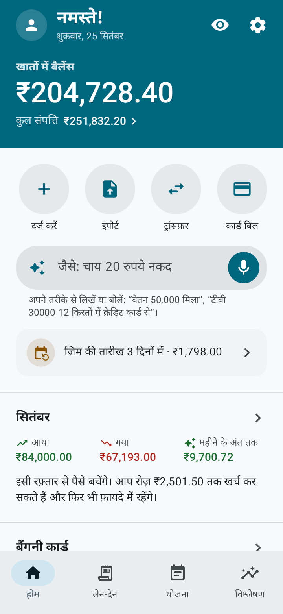
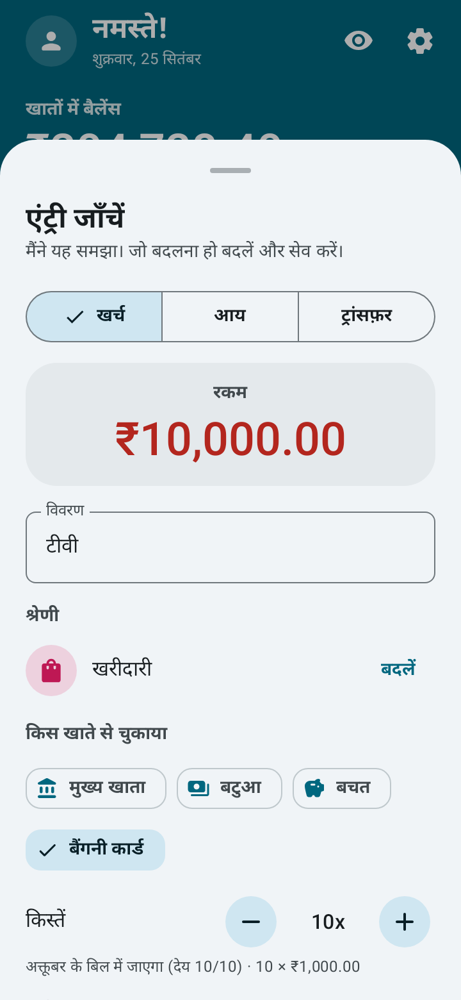
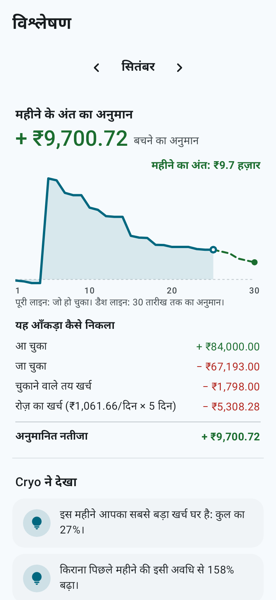
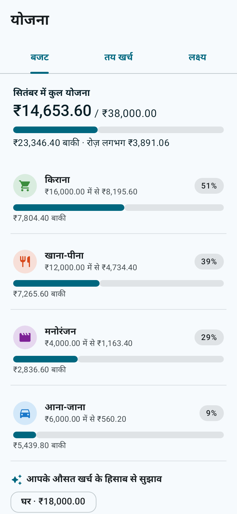
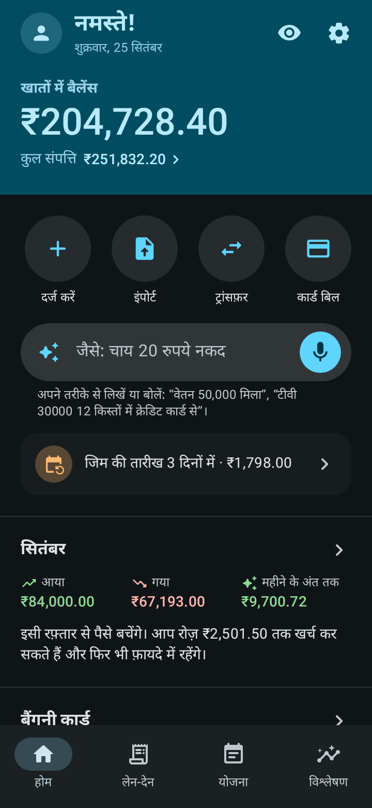

<p align="center">
  
</p>

<h1 align="center">Cryo</h1>

<p align="center"><b>आपका पैसा, बर्फ़ जैसा साफ़।</b><br>
Android के लिए निजी फ़ाइनेंस ऐप: इस्तेमाल में आसान, पूरा, ऑफ़लाइन और ओपन सोर्स।</p>

<p align="center">
  <a href="../../README.md">English</a> ·
  <a href="README.pt-BR.md">Português</a> ·
  <a href="README.es.md">Español</a> ·
  <a href="README.fr.md">Français</a> ·
  <a href="README.de.md">Deutsch</a> ·
  <a href="README.it.md">Italiano</a> ·
  <a href="README.ja.md">日本語</a> ·
  <a href="README.ko.md">한국어</a> ·
  <a href="README.zh-CN.md">中文</a> ·
  <b>हिन्दी</b>
</p>

<p align="center">
  
  
  
  
  
</p>

## यह क्या करता है

- **वाक्य या आवाज़ से दर्ज करें।** "लंच 250" या "टीवी 10000 10 किस्तों में क्रेडिट कार्ड से" लिखें या बोलें। Cryo रकम, श्रेणी, खाता, तारीख़ और किस्तें समझ लेता है। आप बस जाँचें और सेव करें।
- **महीने के आख़िर का अनुमान।** मौजूदा रफ़्तार से महीने के आख़िर में कितना बचेगा और रोज़ कितना खर्च कर सकते हैं।
- **खर्च का कैलेंडर और पैसे का बहाव।** देखें किन दिनों सबसे ज़्यादा खर्च होता है, पैसा कहाँ से आया और कहाँ गया।
- **बैंक स्टेटमेंट इंपोर्ट करें।** OFX, CSV, स्प्रेडशीट (XLSX) या PDF: कुछ भी जुड़ने से पहले आप सूची जाँचते हैं, सुझाई गई श्रेणियों के साथ; जो पहले से Cryo में है वह अनचेक रहता है और क्रेडिट कार्ड बिल का भुगतान पहचान लिया जाता है।
- **क्रेडिट कार्ड।** बिल, उपलब्ध लिमिट और किस्तों में ख़रीदारी, हर किस्त सही बिल में।
- **कर्ज़।** लोन, फ़ाइनेंसिंग, समझौते और किसी से लिया उधार, बाक़ी हिसाब से अलग: कितना बाक़ी है, कौन-सी किस्तें बकाया हैं, आमदनी का कितना हिस्सा किस्तों में जाता है और आप कब कर्ज़-मुक्त होंगे।
- **योजना।** याद दिलाने वाले तय खर्च, हर श्रेणी का बजट और बचत के लक्ष्य, हर महीने की सुझाई गई रकम के साथ।
- **निवेश और खातों के बीच ट्रांसफ़र।**
- **10 भाषाएँ और आपकी मुद्रा।** हिन्दी, अंग्रेज़ी, पुर्तगाली, स्पैनिश, फ़्रेंच, जर्मन, इतालवी, जापानी, कोरियाई और चीनी, आपकी चुनी मुद्रा में (रुपया, डॉलर, यूरो, पाउंड, येन, वॉन, रियाल और दूसरी)। वाक्य से एंट्री और स्टेटमेंट इंपोर्ट सभी भाषाओं में चलते हैं।
- **एक छोटी एनिमेटेड सैर** पहली बार ऐप खोलने पर बताती है कि इसे कैसे इस्तेमाल करें (और जब चाहें, सेटिंग्स में दोबारा)।
- **Material You**, लाइट और डार्क थीम और स्मूद एनिमेशन, जो फ़ोन की "एनिमेशन हटाएँ" सेटिंग मानते हैं।

## निजता

- आपका डेटा सिर्फ़ आपके फ़ोन में रहता है। **ऐप के पास इंटरनेट की अनुमति नहीं है।**
- न साइन-अप, न विज्ञापन, न ट्रैकिंग।
- फ़िंगरप्रिंट, चेहरे या फ़ोन के स्क्रीन लॉक से लॉक।
- **ऑटो बैकअप** फ़ोन के किसी फ़ोल्डर में या आपके क्लाउड (Google Drive, Nextcloud और दूसरे) में, रोज़, हर हफ़्ते या हर महीने। Cryo फ़ाइल को Android के फ़ाइल चुनने वाले से लिखता है, और अपलोड क्लाउड वाला ऐप करता है।
- जब चाहें `.json` फ़ाइल में बैकअप और `.csv` स्प्रेडशीट में एक्सपोर्ट।

आवाज़ से एंट्री फ़ोन में पहले से मौजूद स्पीच रिकग्निशन इस्तेमाल करती है। वाक्य टाइप करना हमेशा काम करता है।

## इंस्टॉल करें

- **F-Droid:** [f-droid.org/packages/io.github.h3yk0.cryo](https://f-droid.org/packages/io.github.h3yk0.cryo/)
- **GitHub:** [Releases](https://github.com/H3yK0/cryo/releases) पेज से `Cryo-<संस्करण>.apk` डाउनलोड करें।

दोनों एक ही फ़ाइल हैं, एक ही चाबी से साइन की हुई: F-Droid कोड को ख़ुद दोबारा बनाता है और तभी प्रकाशित करता है जब नतीजा यहाँ के APK जैसा बिल्कुल एक हो (रिप्रोड्यूसिबल बिल्ड)। इसलिए आप बिना अनइंस्टॉल किए किसी से भी अपडेट कर सकते हैं।

## सोर्स कोड से बनाएँ

ज़रूरी: JDK 21 और Android SDK (प्लेटफ़ॉर्म 36)। प्रकाशित APK उसी JDK 21 से बनता है जो F-Droid इस्तेमाल करता है।

```bash
./gradlew assembleRelease     # बिना साइन का APK app/build/outputs/apk/release/ में
./gradlew testDebugUnitTest   # ऑटोमैटिक टेस्ट (नियम, डेटाबेस, बैकअप, इंपोर्ट और स्क्रीन)
```

अपनी चाबी से साइन करने के लिए `storeFile`, `storePassword`, `keyAlias` और `keyPassword` के साथ `keystore/keystore.properties` बनाएँ। `keystore/` फ़ोल्डर कभी रिपॉज़िटरी में नहीं जाता।

F-Droid पेज और इन README के स्क्रीनशॉट (`fastlane/` फ़ोल्डर) 10 भाषाओं में दोबारा बनाने के लिए:

```bash
./gradlew testDebugUnitTest --tests '*StoreScreenshotsTest' --tests '*StoreAssetsTest' -PstoreAssets=true
```

### कोड कैसे बँटा है

| फ़ोल्डर | सामग्री |
|---|---|
| `domain/` | Android के बिना चलने वाले नियम: बैलेंस, बिल और किस्तें, कर्ज़, अनुमान, पैसे का बहाव, वाक्य समझने वाला (`PhraseParser.kt`, `PhraseLang.kt`), भाषाएँ और मुद्राएँ |
| `importer/` | स्टेटमेंट पढ़ना (OFX, CSV, XLSX, PDF और टेस्ट JSON) और इंपोर्ट से पहले जाँच |
| `data/` | डेटाबेस (Room), सेटिंग्स, बैकअप, डिफ़ॉल्ट श्रेणियाँ और उदाहरण डेटा |
| `ui/` | Jetpack Compose और Material 3 में बनी स्क्रीन |
| `notify/` | तय खर्च और कर्ज़ की किस्तों के रिमाइंडर (WorkManager) |

प्रोजेक्ट के दस्तावेज़ ([docs/PRD.md](../PRD.md) में ज़रूरतें, विज़ुअल गाइड, स्टेटमेंट इंपोर्ट) लेखक की भाषा, पुर्तगाली में लिखे हैं।

## योगदान दें

सुझाव और गड़बड़ियों की रिपोर्ट [Issues](https://github.com/H3yK0/cryo/issues) में स्वागत है, 10 में से किसी भी भाषा में।

- **अनुवाद:** 9 अनुवाद AI की मदद से किए गए हैं। अगर आप इनमें से कोई भाषा बोलते हैं और कुछ अटपटा लगे, तो issue खोलें: मातृभाषी लोगों की समीक्षा का बहुत स्वागत है।
- **आपके बैंक का स्टेटमेंट:** ऐप में एक **डेवलपर मोड** है (सेटिंग्स › जानकारी में संस्करण पर 7 बार टैप करें), जिसमें अलग डेटाबेस और उदाहरण डेटा वाला टेस्ट मोड, हर फ़ॉर्मेट के उदाहरण स्टेटमेंट और एक पढ़ने की रिपोर्ट है जिसे गुमनाम रूप में शेयर किया जा सकता है। अगर आपके बैंक का स्टेटमेंट ठीक से नहीं पढ़ा जाता, तो अपना डेटा भेजे बिना मदद कर सकते हैं: [docs/IMPORTACAO.md](../IMPORTACAO.md#ajudar-a-melhorar-a-leitura) (पुर्तगाली में) देखें।

## लाइसेंस

Copyright © 2026 Hanry Franco

यह प्रोग्राम फ़्री सॉफ़्टवेयर है: आप इसे Free Software Foundation द्वारा प्रकाशित [GNU Affero General Public License](../../LICENSE) के संस्करण 3 या (अपनी पसंद से) किसी बाद के संस्करण की शर्तों के तहत दोबारा बाँट और/या बदल सकते हैं। संस्करण 1.3 तक Cryo, GNU General Public License v3 या बाद के संस्करण के तहत बाँटा गया था। इसे इस उम्मीद से बाँटा जाता है कि यह काम का हो, लेकिन **बिना किसी वारंटी के**। लाइसेंस का आधिकारिक पाठ अंग्रेज़ी मूल है।
