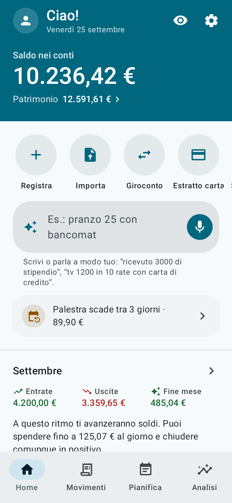
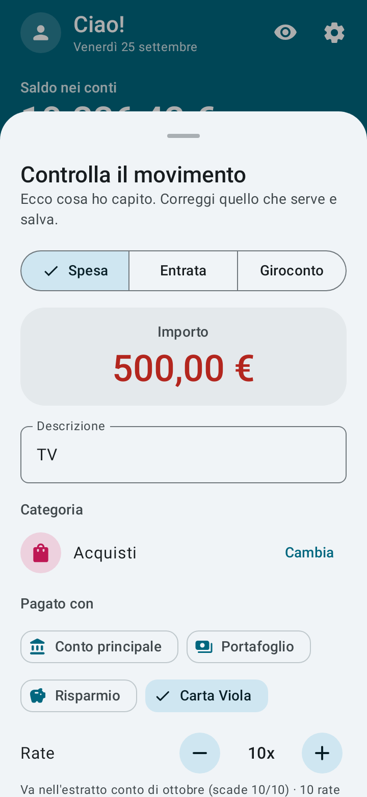
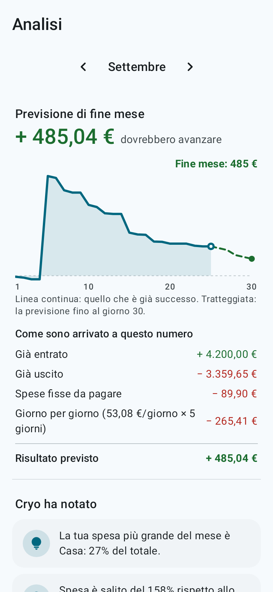
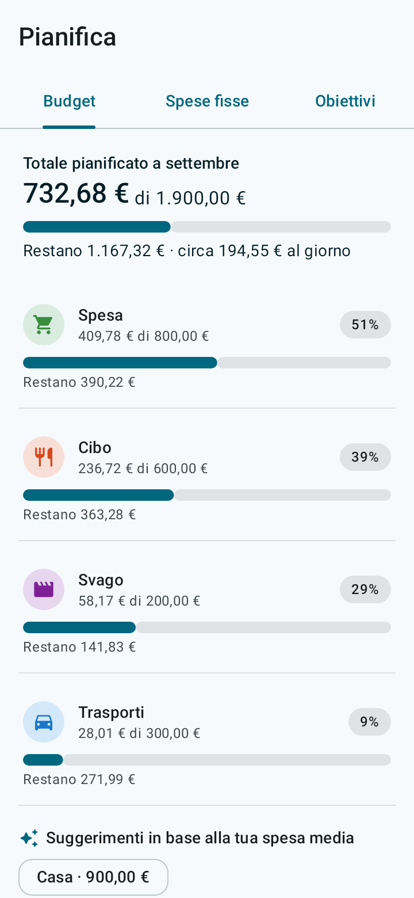
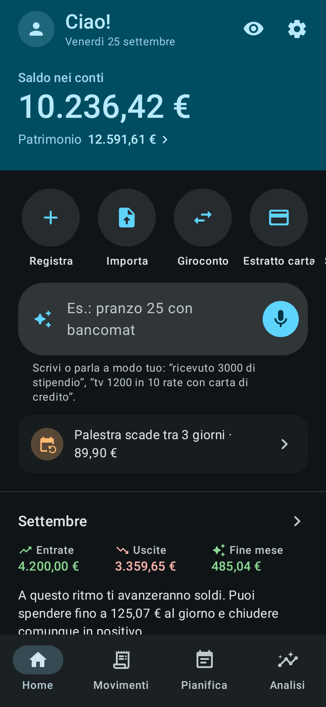

<p align="center">
  
</p>

<h1 align="center">Cryo</h1>

<p align="center"><b>I tuoi soldi, chiari come il ghiaccio.</b><br>
App Android per le finanze personali: semplice, completa, offline e open source.</p>

<p align="center">
  <a href="../../README.md">English</a> ·
  <a href="README.pt-BR.md">Português</a> ·
  <a href="README.es.md">Español</a> ·
  <a href="README.fr.md">Français</a> ·
  <a href="README.de.md">Deutsch</a> ·
  <b>Italiano</b> ·
  <a href="README.ja.md">日本語</a> ·
  <a href="README.ko.md">한국어</a> ·
  <a href="README.zh-CN.md">中文</a> ·
  <a href="README.hi.md">हिन्दी</a>
</p>

<p align="center">
  
  
  
  
  
</p>

## Cosa fa

- **Registrazione a frase o a voce.** Scrivi o di' "pranzo 12,50 con bancomat" o "tv 500 in 10 rate con carta di credito". Cryo capisce l'importo, la categoria, il conto, la data e le rate. Tu controlli e salvi.
- **Previsione di fine mese.** Vedi quanto dovrebbe restare al ritmo attuale e quanto puoi spendere al giorno.
- **Calendario delle spese e flusso del denaro.** Vedi in quali giorni spendi di più, da dove sono arrivati i soldi e dove sono andati.
- **Importa gli estratti conto.** OFX, CSV, foglio di calcolo (XLSX) o PDF: controlli la lista prima che entri, con categorie suggerite, quello che è già in Cryo deselezionato e il pagamento della carta riconosciuto.
- **Carte di credito.** Estratti conto, plafond disponibile e acquisti a rate, ogni rata nell'estratto giusto.
- **Debiti.** Prestiti, finanziamenti, accordi e soldi che devi a qualcuno, separati dal resto: quanto manca, rate in ritardo, quanto del reddito va in rate e quando sarai libero.
- **Pianificazione.** Spese fisse con promemoria, budget per categoria e obiettivi di risparmio con un importo mensile suggerito.
- **Investimenti e trasferimenti** tra conti.
- **10 lingue e la tua valuta.** Italiano, inglese, portoghese, spagnolo, francese, tedesco, giapponese, coreano, cinese e hindi, nella valuta che scegli (euro, franco svizzero, dollaro, sterlina, yen, won, rupia, real e altre). La registrazione a frase e l'importazione degli estratti funzionano in tutte.
- **Un giro animato** mostra come usare l'app la prima volta che la apri (e di nuovo quando vuoi, nelle Impostazioni).
- **Material You**, tema chiaro e scuro e animazioni fluide che seguono l'opzione "Rimuovi animazioni" del telefono.

## Privacy

- I tuoi dati restano sul telefono. **L'app non ha il permesso di accesso a internet.**
- Niente registrazione, niente pubblicità, niente tracciamento.
- Blocco con impronta, volto o blocco schermo del telefono.
- **Backup automatico** in una cartella del telefono o nel tuo cloud (Google Drive, Nextcloud e altri), ogni giorno, ogni settimana o ogni mese. Cryo scrive il file tramite il selettore di file di Android, ed è l'app del cloud a caricarlo.
- Backup in un file `.json` ed esportazione in un foglio `.csv`, quando vuoi.

La registrazione a voce usa il riconoscimento vocale già installato sul telefono. Scrivere la frase funziona sempre.

## Installazione

- **F-Droid:** [f-droid.org/packages/io.github.h3yk0.cryo](https://f-droid.org/packages/io.github.h3yk0.cryo/)
- **GitHub:** scarica `Cryo-<versione>.apk` dalla pagina [Releases](https://github.com/H3yK0/cryo/releases).

Sono lo stesso file, firmato con la stessa chiave: F-Droid ricompila il codice e lo pubblica solo se il risultato è identico all'APK di qui (build riproducibile). Così puoi aggiornare da uno o dall'altro senza disinstallare.

## Compilare dal codice

Requisiti: JDK 21 e l'Android SDK (piattaforma 36). L'APK pubblicato è compilato con JDK 21, lo stesso usato da F-Droid.

```bash
./gradlew assembleRelease     # APK non firmato in app/build/outputs/apk/release/
./gradlew testDebugUnitTest   # test automatici (regole, database, backup, importazione e schermate)
```

Per firmare con la tua chiave, crea `keystore/keystore.properties` con `storeFile`, `storePassword`, `keyAlias` e `keyPassword`. La cartella `keystore/` non va mai nel repository.

Per rigenerare le schermate della pagina F-Droid e di questi README (cartella `fastlane/`), nelle 10 lingue:

```bash
./gradlew testDebugUnitTest --tests '*StoreScreenshotsTest' --tests '*StoreAssetsTest' -PstoreAssets=true
```

### Come è organizzato il codice

| Cartella | Contenuto |
|---|---|
| `domain/` | Regole senza Android: saldi, estratti conto e rate, debiti, previsione, flusso del denaro, l'interprete delle frasi (`PhraseParser.kt`, `PhraseLang.kt`), lingue e valute |
| `importer/` | Lettura degli estratti (OFX, CSV, XLSX, PDF e il JSON di prova) e il controllo prima dell'importazione |
| `data/` | Database (Room), impostazioni, backup, categorie predefinite e dati di esempio |
| `ui/` | Schermate in Jetpack Compose con Material 3 |
| `notify/` | Promemoria delle spese fisse e delle rate dei debiti (WorkManager) |

I documenti del progetto (requisiti in [docs/PRD.md](../PRD.md), guida visiva, importazione degli estratti) sono scritti in portoghese, la lingua dell'autore.

## Contribuire

Suggerimenti e segnalazioni di problemi sono benvenuti in [Issues](https://github.com/H3yK0/cryo/issues), in una qualsiasi delle 10 lingue.

- **Traduzioni:** le 9 traduzioni sono state fatte con l'aiuto dell'IA. Se parli una di queste lingue e qualcosa suona strano, apri una issue: la revisione di madrelingua è molto gradita.
- **L'estratto della tua banca:** l'app ha una **modalità sviluppatore** (tocca 7 volte la versione in Impostazioni › Informazioni) con una modalità di prova che usa un database separato e dati di esempio, estratti di esempio in tutti i formati e un rapporto di lettura condivisibile in versione anonima. Se l'estratto della tua banca non viene letto bene, puoi aiutare senza inviare i tuoi dati: vedi [docs/IMPORTACAO.md](../IMPORTACAO.md#ajudar-a-melhorar-a-leitura) (in portoghese).

## Licenza

Copyright © 2026 Hanry Franco

Questo programma è software libero: puoi ridistribuirlo e/o modificarlo secondo i termini della [GNU Affero General Public License](../../LICENSE) pubblicata dalla Free Software Foundation, nella versione 3 della licenza o (a tua scelta) in qualsiasi versione successiva. Fino alla versione 1.3, Cryo è stato distribuito con la GNU General Public License v3 o successiva. È distribuito nella speranza che sia utile, ma **senza alcuna garanzia**. Il testo ufficiale della licenza è l'originale in inglese.
