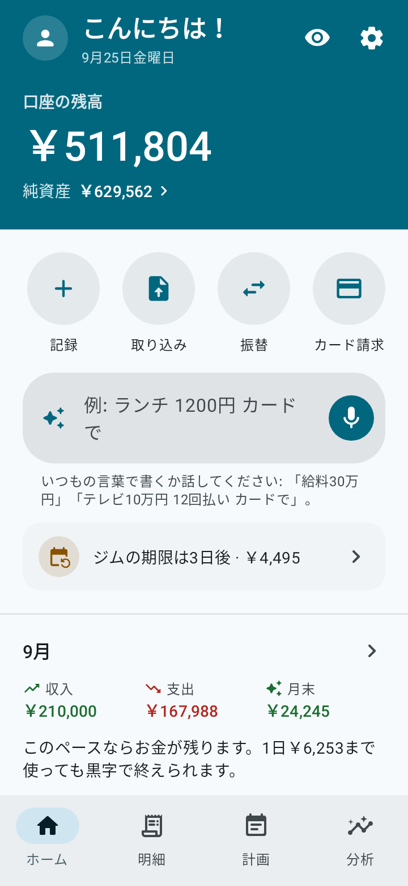
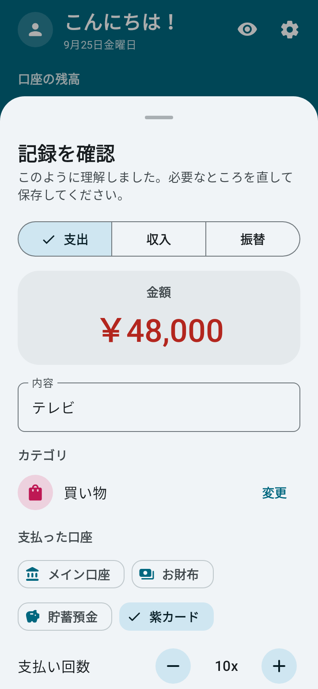
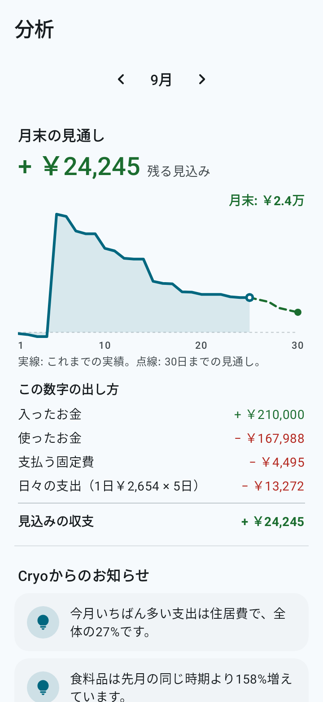
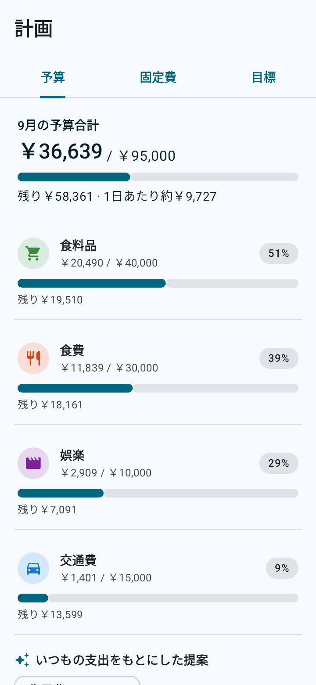
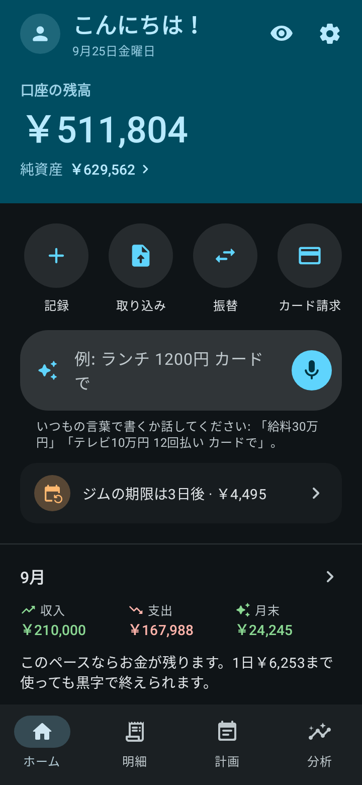

<p align="center">
  
</p>

<h1 align="center">Cryo</h1>

<p align="center"><b>あなたのお金を、氷のようにクリアに。</b><br>
Android向けの家計簿アプリ。シンプルで多機能、オフラインで動くオープンソースです。</p>

<p align="center">
  <a href="../../README.md">English</a> ·
  <a href="README.pt-BR.md">Português</a> ·
  <a href="README.es.md">Español</a> ·
  <a href="README.fr.md">Français</a> ·
  <a href="README.de.md">Deutsch</a> ·
  <a href="README.it.md">Italiano</a> ·
  <b>日本語</b> ·
  <a href="README.ko.md">한국어</a> ·
  <a href="README.zh-CN.md">中文</a> ·
  <a href="README.hi.md">हिन्दी</a>
</p>

<p align="center">
  
  
  
  
  
</p>

## できること

- **文章や音声で記録。**「ランチ 1200」や「テレビ 48000 10回払い カードで」と書くか話すだけ。Cryoが金額・カテゴリ・口座・日付・分割回数を読み取ります。あとは確認して保存するだけです。
- **月末の見通し。** 今のペースで月末にいくら残りそうか、1日あたりいくら使えるかがわかります。
- **支出カレンダーとお金の流れ。** どの日によく使っているか、お金がどこから来てどこへ行ったかが見えます。
- **銀行の明細を取り込み。** OFX、CSV、表計算（XLSX）、PDFに対応。取り込む前に一覧を確認でき、カテゴリの提案、Cryoにすでにある分のチェック外し、カード代金の支払いの自動判別もあります。
- **クレジットカード。** 請求、利用可能枠、分割払い。各回の支払いは正しい請求月に入ります。
- **借金。** ローン、分割の契約、人から借りたお金などをほかと分けて管理。残り、延滞中の支払い、収入のうち返済に回る割合、完済の時期がわかります。
- **計画。** リマインダー付きの固定費、カテゴリごとの予算、毎月の目安額がわかる貯金目標。
- **投資と口座間の振替。**
- **10言語とあなたの通貨。** 日本語、英語、ポルトガル語、スペイン語、フランス語、ドイツ語、イタリア語、韓国語、中国語、ヒンディー語に対応し、通貨も選べます（円、ドル、ユーロ、ポンド、ウォン、ルピー、レアルなど）。文章での記録も明細の取り込みも、すべての言語で使えます。
- **アニメーションのアプリ紹介** で、初めて開いたときに使い方がわかります（設定からいつでも見直せます）。
- **Material You**、ライト／ダークテーマ、なめらかなアニメーション（スマホの「アニメーションを削除」設定に従います）。

## プライバシー

- データはスマホの中だけに保存されます。**このアプリにはインターネットの権限がありません。**
- 登録不要、広告なし、トラッキングなし。
- 指紋・顔認証・画面ロックでアプリをロック。
- **自動バックアップ** をスマホのフォルダやクラウド（Google ドライブ、Nextcloud など）へ、毎日・毎週・毎月。Cryoは Android のファイル選択機能でファイルを書き込み、アップロードはクラウドのアプリが行います。
- `.json` ファイルへのバックアップと `.csv` 表計算への書き出しも、いつでもできます。

音声入力には、スマホにすでに入っている音声認識を使います。文章を入力する方法はいつでも使えます。

## インストール

- **F-Droid:** [f-droid.org/packages/io.github.h3yk0.cryo](https://f-droid.org/packages/io.github.h3yk0.cryo/)
- **GitHub:** [Releases](https://github.com/H3yK0/cryo/releases) ページから `Cryo-<バージョン>.apk` をダウンロードしてください。

どちらも同じ鍵で署名された同じファイルです。F-Droid はコードを自分でビルドし直し、ここにある APK と完全に一致した場合だけ公開します（再現可能なビルド）。そのため、アンインストールせずにどちらからでも更新できます。

## ソースコードからビルド

必要なもの: JDK 21 と Android SDK（プラットフォーム 36）。公開している APK は、F-Droid と同じ JDK 21 でビルドしています。

```bash
./gradlew assembleRelease     # 署名なしの APK が app/build/outputs/apk/release/ にできます
./gradlew testDebugUnitTest   # 自動テスト（ルール、データベース、バックアップ、取り込み、画面）
```

自分の鍵で署名するには、`storeFile`、`storePassword`、`keyAlias`、`keyPassword` を書いた `keystore/keystore.properties` を作ってください。`keystore/` フォルダはリポジトリには入りません。

F-Droid のページとこれらの README の画面画像（`fastlane/` フォルダ）を10言語で作り直すには:

```bash
./gradlew testDebugUnitTest --tests '*StoreScreenshotsTest' --tests '*StoreAssetsTest' -PstoreAssets=true
```

### コードの構成

| フォルダ | 内容 |
|---|---|
| `domain/` | Android に依存しないルール: 残高、請求と分割払い、借金、見通し、お金の流れ、文章の解析（`PhraseParser.kt`、`PhraseLang.kt`）、言語と通貨 |
| `importer/` | 明細の読み込み（OFX、CSV、XLSX、PDF、テスト用 JSON）と取り込み前の確認 |
| `data/` | データベース（Room）、設定、バックアップ、標準カテゴリ、サンプルデータ |
| `ui/` | Jetpack Compose と Material 3 による画面 |
| `notify/` | 固定費と借金の返済のリマインダー（WorkManager） |

プロジェクトの資料（[docs/PRD.md](../PRD.md) の要件、デザインガイド、明細の取り込み）は、作者の言語であるポルトガル語で書かれています。

## 協力する

提案や不具合の報告は [Issues](https://github.com/H3yK0/cryo/issues) へ。10言語のどれでも歓迎します。

- **翻訳:** 9つの翻訳は AI の助けを借りて作りました。これらの言語を話す方で、不自然なところに気づいたら issue を立ててください。ネイティブの方の確認は大歓迎です。
- **あなたの銀行の明細:** アプリには **開発者モード**（設定 › このアプリについて で、バージョンを7回タップ）があり、別のデータベースとサンプルデータを使うテストモード、すべての形式のサンプル明細、匿名版を共有できる読み取りレポートがあります。お使いの銀行の明細がうまく読めない場合は、データを送らずに協力できます: [docs/IMPORTACAO.md](../IMPORTACAO.md#ajudar-a-melhorar-a-leitura)（ポルトガル語）をご覧ください。

## ライセンス

Copyright © 2026 Hanry Franco

このプログラムはフリーソフトウェアです。Free Software Foundation が公開する [GNU Affero General Public License](../../LICENSE) のバージョン3、または（あなたの選択で）それ以降のバージョンの条件のもとで、再配布や改変ができます。バージョン1.3までは GNU General Public License v3 以降で配布していました。役に立つことを願って配布していますが、**いかなる保証もありません**。ライセンスの正式な本文は英語の原文です。
