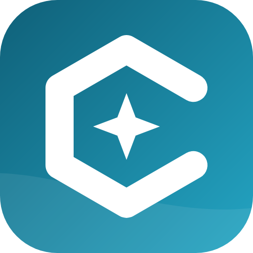
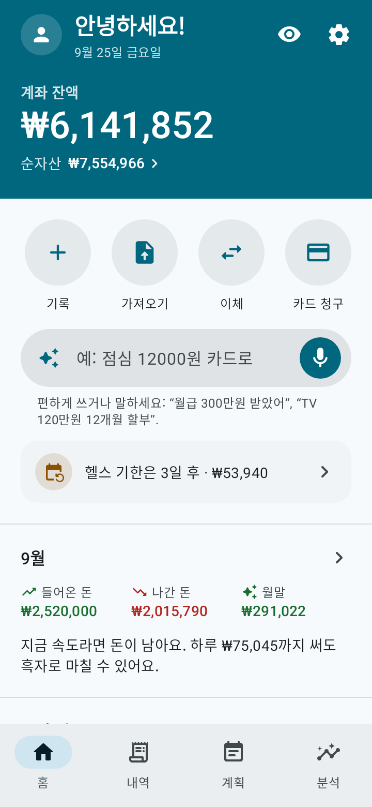
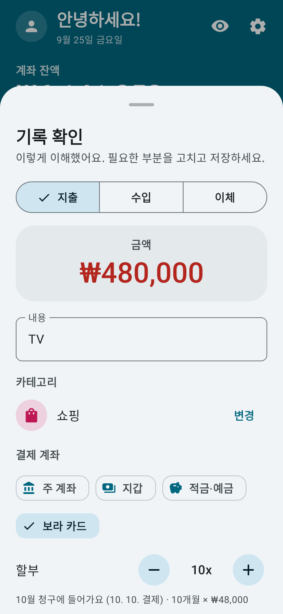
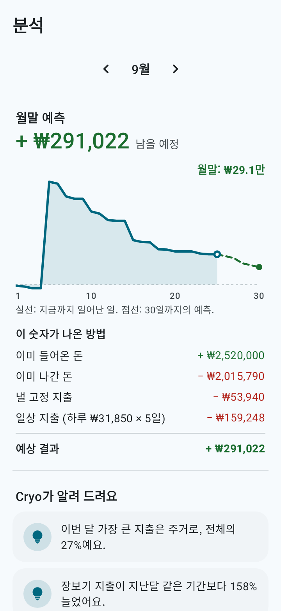
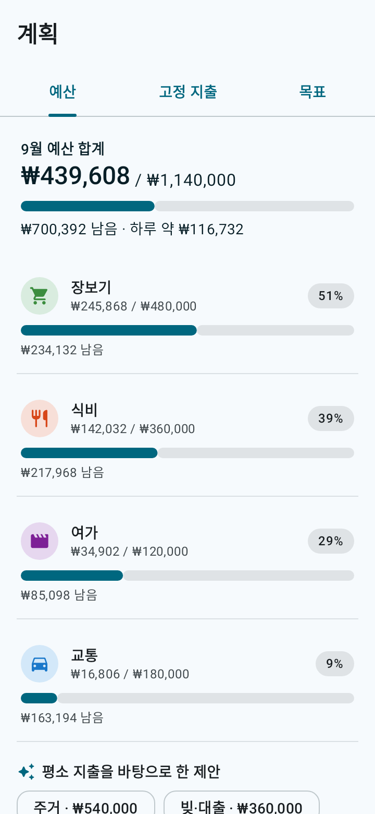
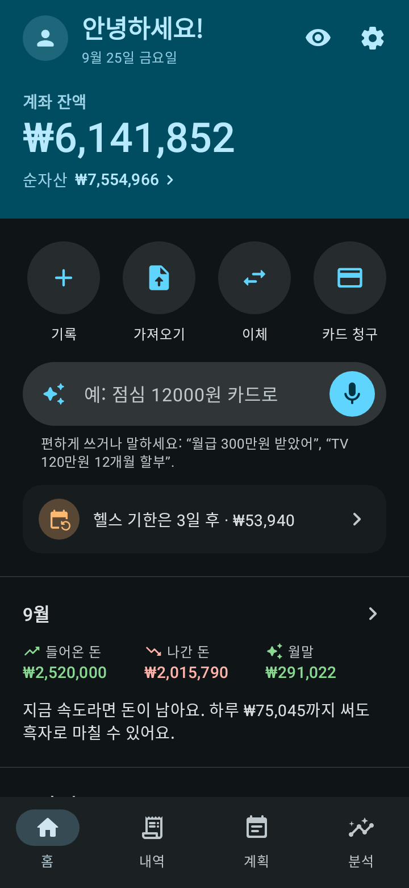

<p align="center">
  
</p>

<h1 align="center">Cryo</h1>

<p align="center"><b>내 돈을 얼음처럼 투명하게.</b><br>
Android용 가계부 앱: 쉽고, 기능이 충분하고, 오프라인으로 동작하는 오픈 소스입니다.</p>

<p align="center">
  <a href="../../README.md">English</a> ·
  <a href="README.pt-BR.md">Português</a> ·
  <a href="README.es.md">Español</a> ·
  <a href="README.fr.md">Français</a> ·
  <a href="README.de.md">Deutsch</a> ·
  <a href="README.it.md">Italiano</a> ·
  <a href="README.ja.md">日本語</a> ·
  <b>한국어</b> ·
  <a href="README.zh-CN.md">中文</a> ·
  <a href="README.hi.md">हिन्दी</a>
</p>

<p align="center">
  
  
  
  
  
</p>

## 할 수 있는 일

- **문장이나 음성으로 기록.** "점심 12000"이나 "TV 480000 10개월 할부"라고 쓰거나 말하세요. Cryo가 금액, 카테고리, 계좌, 날짜, 할부 개월 수를 알아듣습니다. 확인하고 저장만 하면 돼요.
- **월말 예측.** 지금 속도라면 월말에 얼마가 남을지, 하루에 얼마까지 써도 되는지 보여 줍니다.
- **지출 캘린더와 돈의 흐름.** 어느 날 가장 많이 쓰는지, 돈이 어디서 와서 어디로 갔는지 볼 수 있어요.
- **은행 내역 가져오기.** OFX, CSV, 스프레드시트(XLSX), PDF 지원. 가져오기 전에 목록을 확인할 수 있고, 카테고리 제안, 이미 Cryo에 있는 항목 체크 해제, 카드 대금 결제 인식까지 해 줍니다.
- **신용카드.** 청구서, 남은 한도, 할부 구매. 회차마다 맞는 청구서에 들어갑니다.
- **빚.** 대출, 할부 계약, 합의, 다른 사람에게 빌린 돈을 따로 관리: 남은 금액, 연체된 회차, 소득 중 상환에 드는 비율, 다 갚는 시기를 알려 줍니다.
- **계획.** 알림이 있는 고정 지출, 카테고리별 예산, 매달 모을 금액을 알려 주는 저축 목표.
- **투자와 계좌 간 이체.**
- **10개 언어와 내 통화.** 한국어, 영어, 포르투갈어, 스페인어, 프랑스어, 독일어, 이탈리아어, 일본어, 중국어, 힌디어를 지원하고, 통화도 고를 수 있어요(원, 달러, 유로, 파운드, 엔, 루피, 헤알 등). 문장 기록과 내역 가져오기는 모든 언어에서 동작합니다.
- **애니메이션 앱 소개** 로 처음 열 때 사용법을 알려 줍니다(설정에서 언제든 다시 볼 수 있어요).
- **Material You**, 라이트/다크 테마, 휴대폰의 "애니메이션 삭제" 설정을 따르는 부드러운 애니메이션.

## 개인정보

- 데이터는 휴대폰에만 저장됩니다. **이 앱에는 인터넷 권한이 없습니다.**
- 가입 없음, 광고 없음, 추적 없음.
- 지문, 얼굴 인식, 휴대폰 화면 잠금으로 잠금.
- **자동 백업** 을 휴대폰 폴더나 클라우드(Google 드라이브, Nextcloud 등)에 매일, 매주 또는 매달. Cryo는 Android 파일 선택기로 파일을 저장하고, 업로드는 클라우드 앱이 합니다.
- `.json` 파일 백업과 `.csv` 스프레드시트 내보내기도 원할 때 언제든.

음성 기록은 휴대폰에 이미 설치된 음성 인식을 사용합니다. 문장을 입력하는 방법은 언제나 쓸 수 있어요.

## 설치

- **F-Droid:** [f-droid.org/packages/io.github.h3yk0.cryo](https://f-droid.org/packages/io.github.h3yk0.cryo/)
- **GitHub:** [Releases](https://github.com/H3yK0/cryo/releases) 페이지에서 `Cryo-<버전>.apk` 를 내려받으세요.

둘 다 같은 키로 서명된 같은 파일입니다. F-Droid는 코드를 직접 다시 빌드하고, 여기 있는 APK와 똑같을 때만 공개합니다(재현 가능한 빌드). 그래서 삭제하지 않고 어느 쪽에서든 업데이트할 수 있어요.

## 소스 코드로 빌드

필요한 것: JDK 21과 Android SDK(플랫폼 36). 공개된 APK는 F-Droid와 같은 JDK 21로 빌드합니다.

```bash
./gradlew assembleRelease     # 서명되지 않은 APK가 app/build/outputs/apk/release/ 에 생깁니다
./gradlew testDebugUnitTest   # 자동 테스트(규칙, 데이터베이스, 백업, 가져오기, 화면)
```

내 키로 서명하려면 `storeFile`, `storePassword`, `keyAlias`, `keyPassword` 를 적은 `keystore/keystore.properties` 를 만드세요. `keystore/` 폴더는 저장소에 올라가지 않습니다.

F-Droid 페이지와 이 README들의 화면 이미지(`fastlane/` 폴더)를 10개 언어로 다시 만들려면:

```bash
./gradlew testDebugUnitTest --tests '*StoreScreenshotsTest' --tests '*StoreAssetsTest' -PstoreAssets=true
```

### 코드 구성

| 폴더 | 내용 |
|---|---|
| `domain/` | Android 없이 동작하는 규칙: 잔액, 청구서와 할부, 빚, 예측, 돈의 흐름, 문장 해석기(`PhraseParser.kt`, `PhraseLang.kt`), 언어와 통화 |
| `importer/` | 내역 읽기(OFX, CSV, XLSX, PDF, 테스트용 JSON)와 가져오기 전 확인 |
| `data/` | 데이터베이스(Room), 설정, 백업, 기본 카테고리, 예시 데이터 |
| `ui/` | Jetpack Compose와 Material 3로 만든 화면 |
| `notify/` | 고정 지출과 빚 상환 알림(WorkManager) |

프로젝트 문서([docs/PRD.md](../PRD.md)의 요구사항, 디자인 가이드, 내역 가져오기)는 작성자의 언어인 포르투갈어로 쓰여 있습니다.

## 참여하기

제안과 버그 신고는 [Issues](https://github.com/H3yK0/cryo/issues) 에 남겨 주세요. 10개 언어 중 어떤 언어든 좋습니다.

- **번역:** 9개 번역은 AI의 도움을 받아 만들었습니다. 이 언어를 쓰시는 분이 어색한 부분을 발견하면 issue를 열어 주세요. 원어민의 검토를 크게 환영합니다.
- **내 은행 내역:** 앱에는 **개발자 모드**(설정 › 정보 에서 버전을 7번 탭)가 있어요. 별도의 데이터베이스와 예시 데이터를 쓰는 테스트 모드, 모든 형식의 예시 내역, 익명 버전으로 공유할 수 있는 읽기 보고서가 있습니다. 내 은행 내역이 제대로 읽히지 않으면 데이터를 보내지 않고도 도울 수 있어요: [docs/IMPORTACAO.md](../IMPORTACAO.md#ajudar-a-melhorar-a-leitura)(포르투갈어)를 보세요.

## 라이선스

Copyright © 2026 Hanry Franco

이 프로그램은 자유 소프트웨어입니다. Free Software Foundation이 발표한 [GNU Affero General Public License](../../LICENSE) 버전 3 또는 (원하는 경우) 그 이후 버전의 조건에 따라 재배포하거나 수정할 수 있습니다. 버전 1.3까지 Cryo는 GNU General Public License v3 이상으로 배포되었습니다. 유용하기를 바라며 배포하지만 **어떠한 보증도 없습니다**. 라이선스의 공식 본문은 영어 원문입니다.
