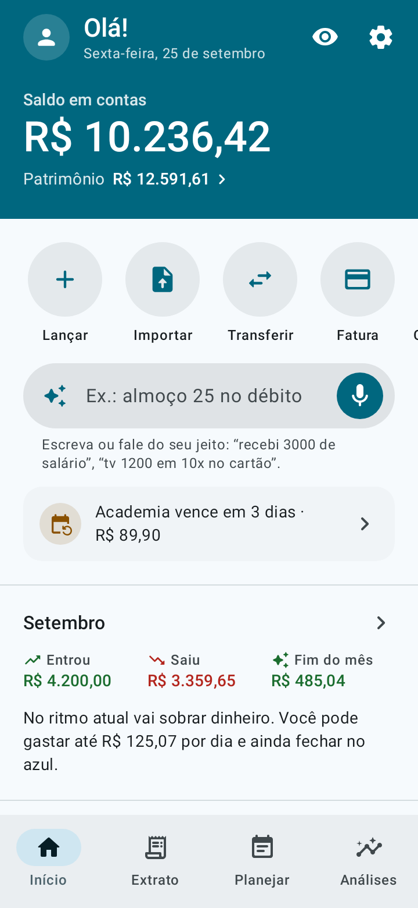
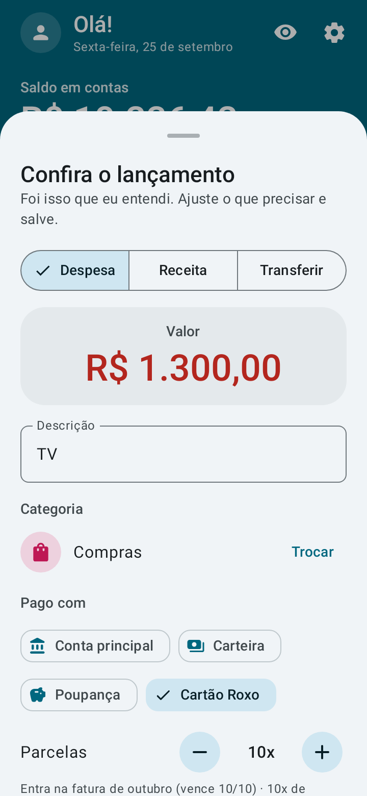
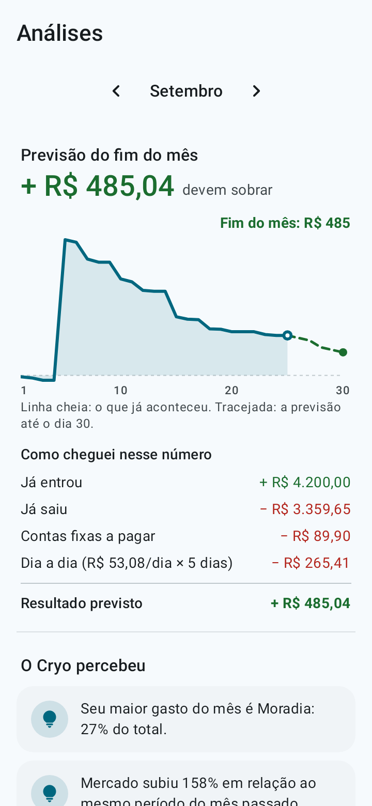
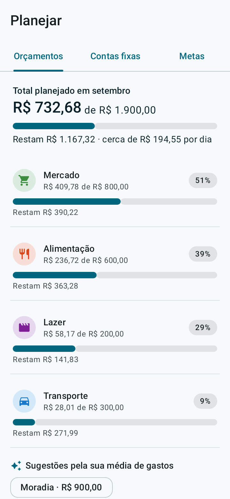
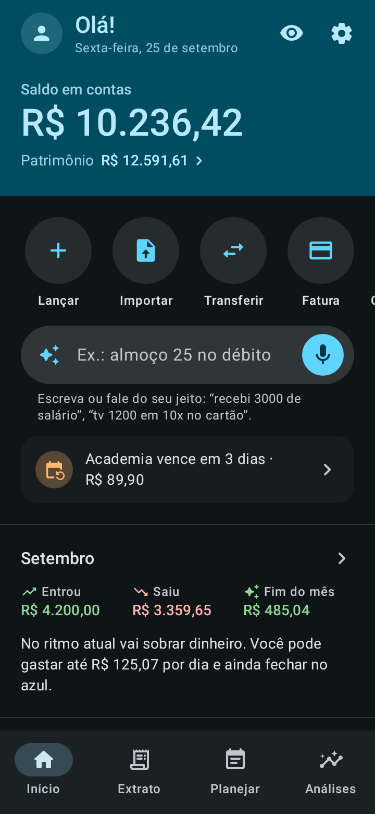

<p align="center">
  
</p>

<h1 align="center">Cryo</h1>

<p align="center"><b>Seu dinheiro, claro como gelo.</b><br>
App Android de finanças pessoais: simples de usar, completo, offline e de código aberto.</p>

<p align="center">
  <a href="../../README.md">English</a> ·
  <b>Português</b> ·
  <a href="README.es.md">Español</a> ·
  <a href="README.fr.md">Français</a> ·
  <a href="README.de.md">Deutsch</a> ·
  <a href="README.it.md">Italiano</a> ·
  <a href="README.ja.md">日本語</a> ·
  <a href="README.ko.md">한국어</a> ·
  <a href="README.zh-CN.md">中文</a> ·
  <a href="README.hi.md">हिन्दी</a>
</p>

<p align="center">
  
  
  
  
  
</p>

## O que ele faz

- **Registro por frase ou voz.** Escreva ou fale "almoço 32,50 no débito" ou "tv 1300 em 10x no cartão". O Cryo entende o valor, a categoria, a conta, a data e as parcelas. Você só confere e salva.
- **Previsão do fim do mês.** Mostra quanto deve sobrar no ritmo atual e quanto dá para gastar por dia.
- **Calendário de calor e fluxo do dinheiro.** Veja em quais dias você mais gasta, de onde o dinheiro veio e para onde foi.
- **Importar extrato do banco.** OFX, CSV, planilha (XLSX) ou PDF: você confere a lista antes de entrar, com categorias sugeridas, o que já está no Cryo desmarcado e o pagamento da fatura do cartão reconhecido.
- **Cartões de crédito.** Faturas, limite disponível e compras parceladas, cada parcela na fatura certa.
- **Dívidas.** Empréstimos, financiamentos, acordos e dinheiro que você deve a alguém, separados do resto: quanto falta, parcelas atrasadas, quanto da renda vai para parcelas e quando você fica livre.
- **Planejamento.** Contas fixas com lembrete, orçamento por categoria e metas com valor mensal sugerido.
- **Investimentos e transferências** entre contas.
- **10 línguas e a sua moeda.** Português, inglês, espanhol, francês, alemão, italiano, japonês, coreano, chinês e hindi, na moeda que você escolher (real, dólar, euro, libra, iene, won, rúpia e outras). O registro por frase e a importação de extratos funcionam em todas elas.
- **Um passeio animado** mostra como usar o app na primeira vez (e de novo quando quiser, em Ajustes).
- **Material You**, tema claro e escuro e animações suaves, que seguem a opção "Remover animações" do celular.

## Privacidade

- Os dados ficam só no celular. **O app não tem permissão de internet.**
- Sem cadastro, sem anúncios e sem rastreamento.
- Bloqueio com digital, rosto ou senha do aparelho.
- **Backup automático** numa pasta do celular ou na sua nuvem (Google Drive, Nextcloud e outras), todo dia, toda semana ou todo mês. O Cryo grava o arquivo pelo seletor de arquivos do Android, e quem envia para a internet é o app da nuvem.
- Backup em arquivo `.json` e exportação para planilha `.csv`, quando você quiser.

O registro por voz usa o reconhecimento de fala que já está instalado no celular. Digitar a frase funciona sempre.

## Instalação

- **F-Droid:** [f-droid.org/packages/io.github.h3yk0.cryo](https://f-droid.org/packages/io.github.h3yk0.cryo/)
- **GitHub:** baixe o `Cryo-<versão>.apk` na página de [Releases](https://github.com/H3yK0/cryo/releases).

Os dois são o mesmo arquivo, assinado pela mesma chave: o F-Droid compila o código de novo e só publica se o resultado for idêntico ao APK daqui (compilação reproduzível). Por isso dá para atualizar por qualquer um dos dois sem desinstalar.

## Compilar a partir do código

Requisitos: JDK 21 e o Android SDK (plataforma 36). O APK publicado é compilado com o JDK 21, o mesmo usado pelo F-Droid.

```bash
./gradlew assembleRelease     # APK sem assinatura em app/build/outputs/apk/release/
./gradlew testDebugUnitTest   # testes automáticos (regras, banco de dados, backup, importação e telas)
```

Para assinar com a sua própria chave, crie `keystore/keystore.properties` com `storeFile`, `storePassword`, `keyAlias` e `keyPassword`. A pasta `keystore/` nunca vai para o repositório.

Para gerar de novo as imagens da página do F-Droid e destes READMEs (pasta `fastlane/`), nas 10 línguas:

```bash
./gradlew testDebugUnitTest --tests '*StoreScreenshotsTest' --tests '*StoreAssetsTest' -PstoreAssets=true
```

### Como o código está organizado

| Pasta | Conteúdo |
|---|---|
| `domain/` | Regras sem Android: saldos, faturas e parcelas, dívidas, previsão, fluxo do dinheiro, o interpretador de frases (`PhraseParser.kt`, `PhraseLang.kt`), línguas e moedas |
| `importer/` | Leitura de extratos (OFX, CSV, XLSX, PDF e o JSON de teste) e a conferência antes de importar |
| `data/` | Banco de dados (Room), ajustes, backup, categorias padrão e dados de exemplo |
| `ui/` | Telas em Jetpack Compose com Material 3 |
| `notify/` | Lembretes de contas fixas e parcelas de dívidas (WorkManager) |

Os documentos do projeto (requisitos em [docs/PRD.md](../PRD.md), guia visual, importação de extratos) são escritos em português.

## Contribuir

Sugestões e relatos de problemas são bem-vindos na aba [Issues](https://github.com/H3yK0/cryo/issues), em qualquer uma das 10 línguas.

- **Traduções:** as 9 traduções foram feitas com a ajuda de IA. Se você fala uma dessas línguas e achar algo estranho, abra uma issue: a revisão de quem fala a língua é muito bem-vinda.
- **Extrato do seu banco:** o app tem um **modo desenvolvedor** (7 toques na versão, em Ajustes › Sobre) com um modo de teste que usa um banco de dados separado e dados de exemplo, extratos de exemplo em todos os formatos e um relatório de leitura que pode ser compartilhado em versão anônima. Se o extrato do seu banco não for lido direito, veja como ajudar sem mandar os seus dados em [docs/IMPORTACAO.md](../IMPORTACAO.md#ajudar-a-melhorar-a-leitura).

## Licença

Copyright © 2026 Hanry Franco

Este programa é software livre: você pode redistribuí-lo e/ou modificá-lo sob os termos da [GNU Affero General Public License](../../LICENSE), publicada pela Free Software Foundation, versão 3 da licença ou (a seu critério) qualquer versão posterior. Até a versão 1.3, o Cryo foi distribuído sob a GNU General Public License v3 ou posterior. Ele é distribuído na esperança de ser útil, mas **sem nenhuma garantia**.
