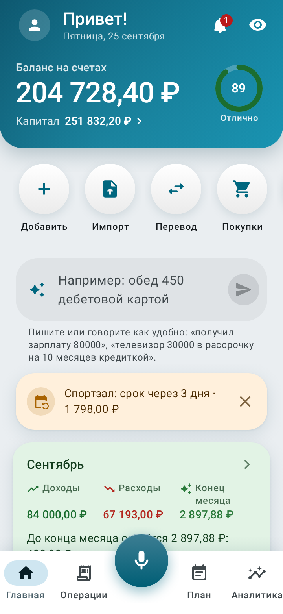
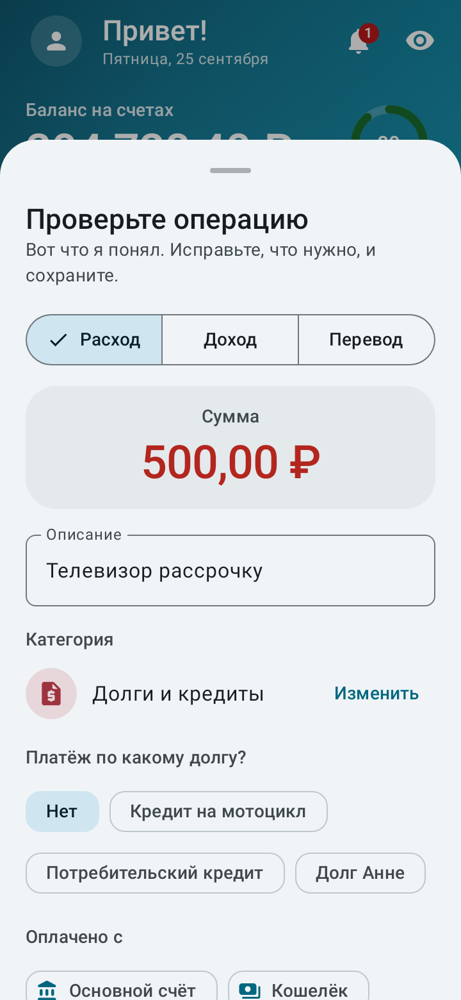
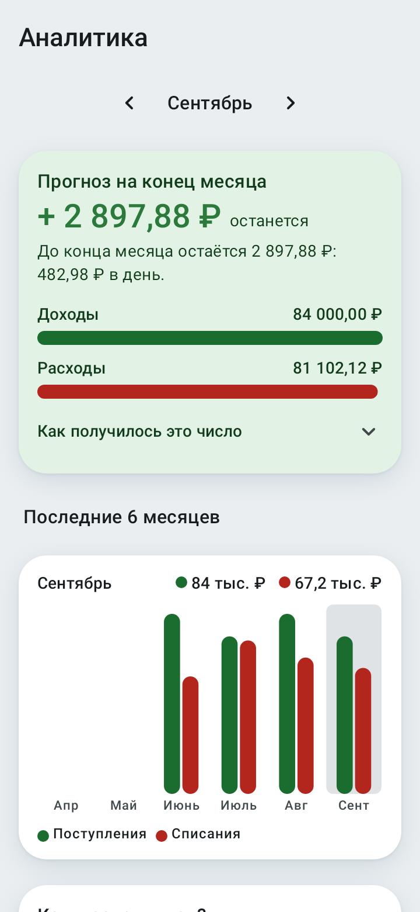
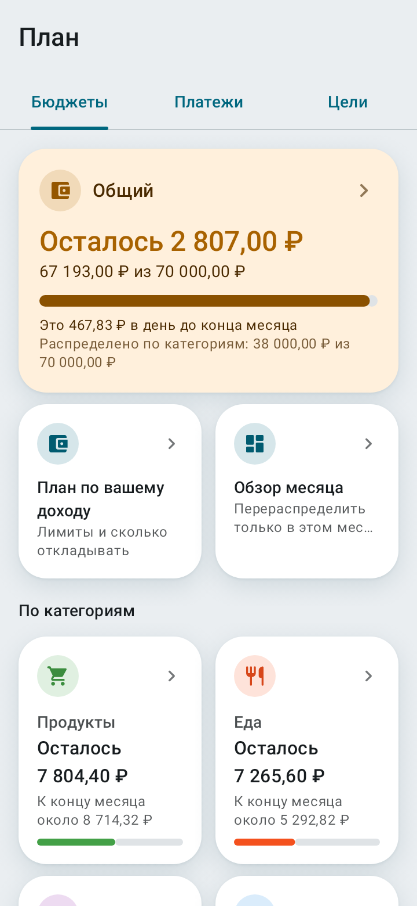
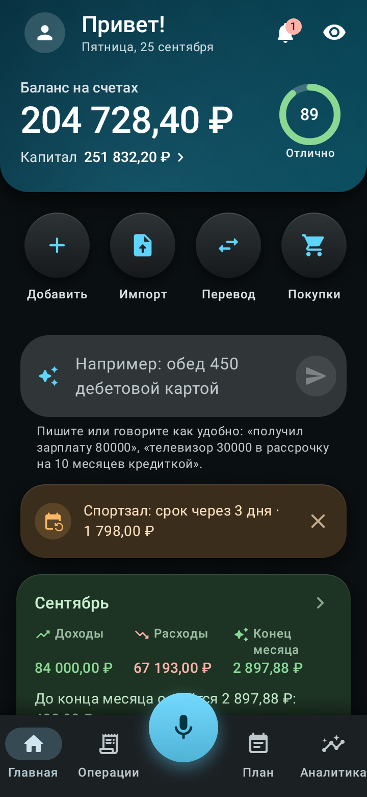

<p align="center">
  
</p>

<h1 align="center">Cryo</h1>

<p align="center"><b>Ваши деньги, ясно как лёд.</b><br>
Приложение для личных финансов на Android: простое, полное, без интернета и с открытым кодом.</p>

<p align="center">
  <a href="../../README.md">English</a> ·
  <a href="README.pt-BR.md">Português</a> ·
  <a href="README.es.md">Español</a> ·
  <a href="README.fr.md">Français</a> ·
  <a href="README.de.md">Deutsch</a> ·
  <a href="README.it.md">Italiano</a> ·
  <a href="README.ja.md">日本語</a> ·
  <a href="README.ko.md">한국어</a> ·
  <a href="README.zh-CN.md">中文</a> ·
  <a href="README.hi.md">हिन्दी</a> ·
  <b>Русский</b> ·
  <a href="README.uk.md">Українська</a> ·
  <a href="README.ar.md">العربية</a> ·
  <a href="README.he.md">עברית</a>
</p>

<p align="center">
  
  
  
  
  
</p>

## Что умеет

- **Запись текстом или голосом.** Напишите или скажите «обед 350 с карты» или «телевизор 30000 в рассрочку на 12 месяцев». Cryo понимает сумму, категорию, счёт, дату и рассрочку. Вам остаётся проверить и сохранить.
- **Финансовый движок на телефоне.** Прогноз на конец месяца с диапазоном, проверенным на вашем прошлом, и его число — всегда сумма строк, которые его объясняют, включая регулярные платежи, бюджеты и вложения. Cryo сам находит зарплату, аренду и подписки, отвечает на вопрос **«Как я закончу год?»** красными сигналами в днях, которые требуют внимания, говорит, **укладываются ли цели** в нынешний темп, отмечает необычные и повторные списания, показывает оценку финансового здоровья (рядом с балансом), скрытые проценты долгов с планом погашения и реальную годовую доходность инвестиций. Всё считается без интернета.
- **Календарь трат и движение денег.** В какие дни вы тратите больше — в цветах температуры, откуда пришли деньги и куда ушли — полосами или воронкой. Нажмите на часть, чтобы увидеть её операции.
- **Импорт банковских выписок.** OFX, CSV, таблица (XLSX) или PDF: вы проверяете список до добавления, с предложенными категориями; то, что уже есть в Cryo, не отмечено, а оплаты кредитной карты распознаются.
- **Кредитные карты.** Выписки, доступный лимит и покупки в рассрочку, каждый платёж в нужной выписке.
- **Долги.** Кредиты, рассрочки, договорённости и деньги, которые вы кому-то должны, отдельно от остального: сколько осталось, просрочки, какая часть дохода уходит на платежи и когда вы закроете всё.
- **Планирование.** Регулярные платежи (ежемесячные, ежегодные или частями) с напоминаниями, предстоящие платежи в выписке и пропуск месяца, бюджет по категориям — или **по вашему доходу** — с предупреждением, когда платежи в него не помещаются, и цели накоплений.
- **Выписка по каждому счёту**, как в банке: у каждой операции остаток после неё и остаток на конец дня. В общей выписке у каждой операции видно её счёт, и можно отфильтровать по одному.
- **Инвестиции и переводы** между счетами.
- **14 языков и ваша валюта.** Английский, португальский, испанский, французский, немецкий, итальянский, японский, корейский, китайский, хинди, русский, украинский, арабский и иврит (справа налево), в выбранной валюте (рубль, гривна, доллар, евро, фунт, иена, вона, рупия, шекель, риял и другие). Запись фразой и импорт выписок работают на всех.
- **Короткий анимированный тур** показывает, как пользоваться приложением, при первом запуске (и в любое время в Настройках).
- **Виджет на главном экране** любого размера и с тем, что важно вам: конец месяца, баланс на счетах, остаток общего бюджета или капитал, а под ними ближайшие платежи, бюджеты или цели и кнопка «Добавить».
- **Экраны — как вам удобно.** Листайте вбок, чтобы сменить вкладку, и настройте каждый экран: блоки в нужном порядке, а ненужные можно скрыть.
- **Material You**, светлая и тёмная темы и плавные анимации, которые следуют настройке «Удалить анимацию» телефона.

## Приватность

- Данные остаются на телефоне. **У приложения нет доступа к интернету.**
- Без регистрации, рекламы и слежки.
- Блокировка отпечатком, лицом или блокировкой экрана телефона — снова сразу или через выбранное время — и необязательный **режим конфиденциальности**, при котором скриншоты и запись экрана получаются чёрными.
- **Автоматическая резервная копия** в папку на телефоне или в ваше облако (Google Drive, Nextcloud и другие) — каждый день, неделю или месяц. Cryo записывает файл через выбор файлов Android, а загружает его приложение облака.
- **Резервные копии с паролем** (по желанию): файлы шифруются AES-256 и не читаются без вашего пароля. Ключ хранится в защищённом хранилище Android.
- Копия в файл `.json` и экспорт в таблицу `.csv` — когда захотите.

**Голос, который остаётся на телефоне.** Голос распознаётся прямо на телефоне с помощью Whisper (открытая модель речи); запись никогда не становится файлом. Модель скачивается один раз в браузере — у Cryo нет доступа к интернету, — и Cryo принимает только официальный файл, проверяя его SHA-256 ([модели](../VOZ-MODELOS.md)). Без неё используется распознавание самого телефона. Ввод фразы текстом работает всегда.

## Установка

- **F-Droid:** [f-droid.org/packages/io.github.h3yk0.cryo](https://f-droid.org/packages/io.github.h3yk0.cryo/)
- **GitHub:** скачайте `Cryo-<версия>.apk` на странице [Releases](https://github.com/H3yK0/cryo/releases).

Это один и тот же файл, подписанный одним ключом: F-Droid собирает код заново и публикует его, только если результат совпадает с APK здесь (воспроизводимая сборка). Поэтому можно обновляться из любого источника без удаления.

## Сборка из исходников

Нужны JDK 21 и Android SDK (платформа 36). Публикуемый APK собирается на JDK 21, как и в F-Droid.

```bash
./gradlew assembleRelease     # неподписанный APK в app/build/outputs/apk/release/
./gradlew testDebugUnitTest   # автотесты (правила, база данных, копии, импорт и экраны)
```

Чтобы подписать своим ключом, создайте `keystore/keystore.properties` с `storeFile`, `storePassword`, `keyAlias` и `keyPassword`. Папка `keystore/` никогда не попадает в репозиторий.

Чтобы заново создать снимки экранов страницы F-Droid и этих README (папка `fastlane/`) на 14 языках:

```bash
./gradlew testDebugUnitTest --tests '*StoreScreenshotsTest' --tests '*StoreAssetsTest' -PstoreAssets=true
```

### Как устроен код

| Папка | Что внутри |
|---|---|
| `domain/` | Правила без Android: балансы, платежи и рассрочки, долги, прогноз, движение денег, разбор фраз (`PhraseParser.kt`, `PhraseLang.kt`), языки и валюты |
| `importer/` | Чтение выписок (OFX, CSV, XLSX, PDF и тестовый JSON) и проверка перед импортом |
| `data/` | База данных (Room), настройки, резервные копии, категории по умолчанию и примеры данных |
| `ui/` | Экраны на Jetpack Compose с Material 3 |
| `notify/` | Напоминания о регулярных платежах и платежах по долгам (WorkManager) |

Документы проекта (требования в [docs/PRD.md](../PRD.md), визуальный гид, импорт выписок) написаны на португальском, языке автора.

## Как помочь

Предложения и сообщения об ошибках приветствуются в [Issues](https://github.com/H3yK0/cryo/issues), на любом из 14 языков.

- **Переводы:** 13 переводов сделаны с помощью ИИ. Если вы говорите на одном из этих языков и заметили что-то странное, откройте issue: проверка носителями очень приветствуется.
- **Выписки вашего банка:** в приложении есть **режим разработчика** (нажмите на версию 7 раз в Настройки › О приложении) с тестовым режимом на отдельной базе и примерах, примерами выписок во всех форматах и отчётом о чтении, которым можно поделиться в анонимном виде. Если выписка вашего банка читается неправильно, можно помочь, не отправляя свои данные: см. [docs/IMPORTACAO.md](../IMPORTACAO.md#ajudar-a-melhorar-a-leitura) (на португальском).

## Поддержка

Cryo бесплатный, без рекламы, слежки и доступа к интернету. Если он вам помогает и хочется угостить автора кофе — это очень приятно и совсем не обязательно.

<a href="https://www.buymeacoffee.com/H3YK0" target="_blank"></a> <a href="https://github.com/sponsors/H3yK0" target="_blank"></a>

## Лицензия

Copyright © 2026 Hanry Franco

Эта программа — свободное ПО: вы можете распространять и/или изменять её на условиях [GNU Affero General Public License](../../LICENSE), опубликованной Free Software Foundation, версии 3 или (по вашему выбору) любой более поздней. До версии 1.3 Cryo распространялся по GNU General Public License v3 или более поздней. Она распространяется в надежде, что будет полезной, но **без каких-либо гарантий**.
