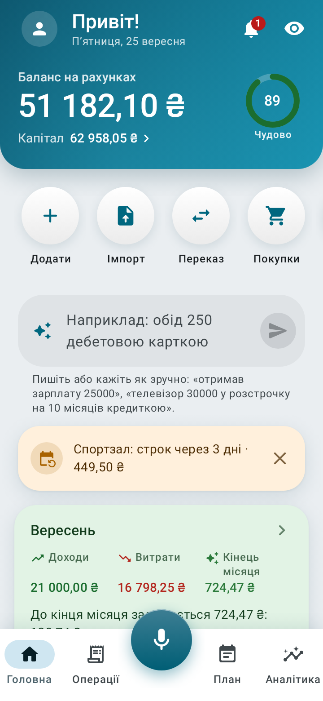
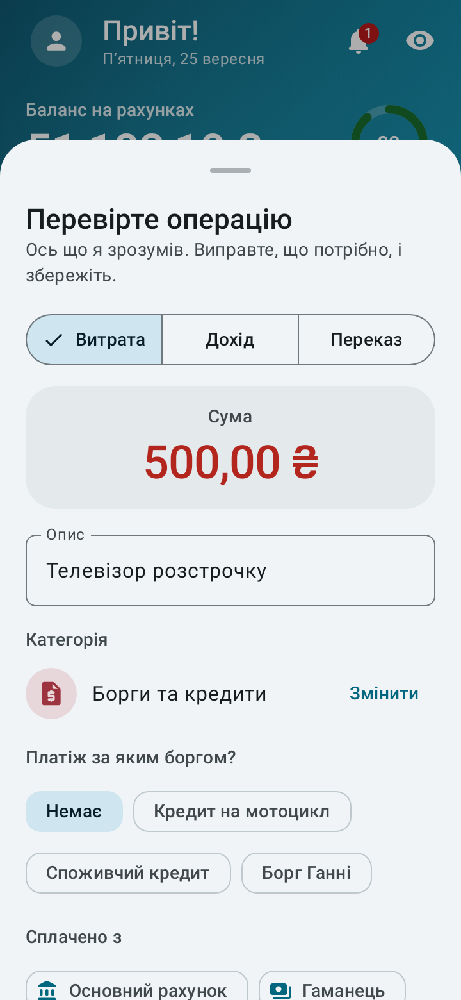
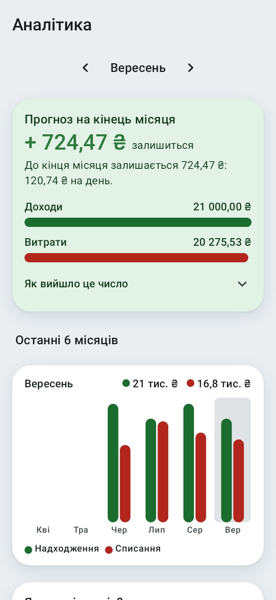
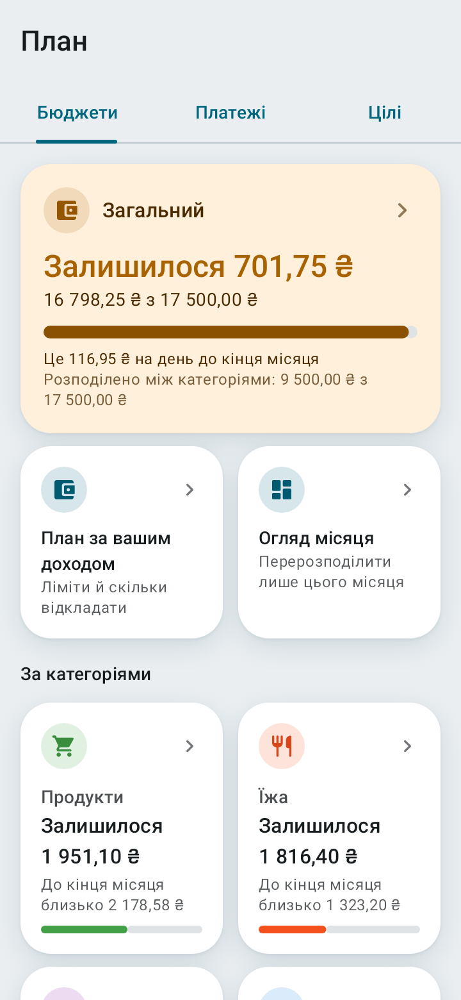
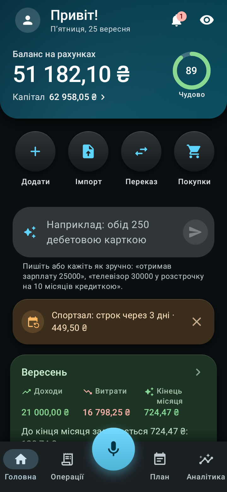

<p align="center">
  
</p>

<h1 align="center">Cryo</h1>

<p align="center"><b>Ваші гроші, ясно як лід.</b><br>
Застосунок для особистих фінансів на Android: простий, повний, без інтернету та з відкритим кодом.</p>

<p align="center">
  <a href="../../README.md">English</a> ·
  <a href="README.pt-BR.md">Português</a> ·
  <a href="README.es.md">Español</a> ·
  <a href="README.fr.md">Français</a> ·
  <a href="README.de.md">Deutsch</a> ·
  <a href="README.it.md">Italiano</a> ·
  <a href="README.ja.md">日本語</a> ·
  <a href="README.ko.md">한국어</a> ·
  <a href="README.zh-CN.md">中文</a> ·
  <a href="README.hi.md">हिन्दी</a> ·
  <a href="README.ru.md">Русский</a> ·
  <b>Українська</b> ·
  <a href="README.ar.md">العربية</a> ·
  <a href="README.he.md">עברית</a>
</p>

<p align="center">
  
  
  
  
  
</p>

## Що вміє

- **Запис текстом або голосом.** Напишіть або скажіть «обід 200 карткою» чи «телевізор 30000 у розстрочку на 12 місяців». Cryo розуміє суму, категорію, рахунок, дату й розстрочку. Вам залишається перевірити й зберегти.
- **Фінансовий рушій на телефоні.** Прогноз на кінець місяця з діапазоном, перевіреним на вашому минулому, і його число — завжди сума рядків, що його пояснюють, разом із регулярними платежами, бюджетами й вкладеннями. Cryo сам знаходить зарплату, оренду й підписки, відповідає на питання **«Як я закінчу рік?»** червоними сигналами в днях, що потребують уваги, каже, **чи вміщаються цілі** в нинішній темп, позначає незвичні й повторні списання, показує оцінку фінансового здоров'я (поруч із балансом), приховані відсотки боргів із планом погашення та реальну річну дохідність інвестицій. Усе рахується без інтернету.
- **Календар витрат і рух грошей.** У які дні ви витрачаєте більше, звідки прийшли гроші й куди пішли.
- **Імпорт банківських виписок.** OFX, CSV, таблиця (XLSX) або PDF: ви перевіряєте список до додавання, із запропонованими категоріями; те, що вже є в Cryo, не позначено, а оплати кредитної картки розпізнаються.
- **Кредитні картки.** Виписки, доступний ліміт і покупки в розстрочку, кожен платіж у правильній виписці.
- **Борги.** Кредити, розстрочки, домовленості й гроші, які ви комусь винні, окремо від решти: скільки залишилося, прострочення, яка частина доходу йде на платежі й коли ви все закриєте.
- **Планування.** Регулярні платежі (щомісячні, щорічні або частинами) з нагадуваннями, майбутні платежі у виписці й пропуск місяця, бюджет за категоріями — або **за вашим доходом** — з попередженням, коли платежі в нього не вміщаються, і цілі заощаджень.
- **Виписка за кожним рахунком**, як у банку: біля кожної операції залишок після неї та залишок на кінець дня. У загальній виписці біля кожної операції видно її рахунок, і можна відфільтрувати за одним.
- **Інвестиції й перекази** між рахунками.
- **14 мов і ваша валюта.** Англійська, португальська, іспанська, французька, німецька, італійська, японська, корейська, китайська, гінді, російська, українська, арабська та іврит (справа наліво), у вибраній валюті (гривня, рубль, долар, євро, фунт, єна, вона, рупія, шекель, ріял та інші). Запис фразою й імпорт виписок працюють усіма мовами.
- **Короткий анімований тур** показує, як користуватися застосунком, під час першого запуску (і будь-коли в Налаштуваннях).
- **Material You**, світла й темна теми та плавні анімації, що зважають на налаштування «Вимкнути анімацію» телефона.

## Приватність

- Дані залишаються на телефоні. **Застосунок не має доступу до інтернету.**
- Без реєстрації, реклами й стеження.
- Блокування відбитком, обличчям або блокуванням екрана телефона.
- **Автоматична резервна копія** в папку на телефоні або у ваше хмарне сховище (Google Drive, Nextcloud та інші) — щодня, щотижня або щомісяця. Cryo записує файл через вибір файлів Android, а завантажує його застосунок хмари.
- **Резервні копії з паролем** (за бажанням): файли шифруються AES-256 і не читаються без вашого пароля. Ключ зберігається в захищеному сховищі Android.
- Копія у файл `.json` і експорт у таблицю `.csv` — коли захочете.

**Голос, що залишається на телефоні.** Голос розпізнається просто на телефоні за допомогою Whisper (відкрита модель мовлення); запис ніколи не стає файлом. Модель завантажується один раз у браузері — Cryo не має доступу до інтернету, — і Cryo приймає лише офіційний файл, перевіряючи його SHA-256 ([моделі](../VOZ-MODELOS.md)). Без неї використовується розпізнавання самого телефона. Введення фрази текстом працює завжди.

## Установлення

- **F-Droid:** [f-droid.org/packages/io.github.h3yk0.cryo](https://f-droid.org/packages/io.github.h3yk0.cryo/)
- **GitHub:** завантажте `Cryo-<версія>.apk` на сторінці [Releases](https://github.com/H3yK0/cryo/releases).

Це той самий файл, підписаний тим самим ключем: F-Droid збирає код заново й публікує його, лише якщо результат збігається з APK тут (відтворювана збірка). Тож можна оновлюватися з будь-якого джерела без видалення.

## Збирання з вихідного коду

Потрібні JDK 21 і Android SDK (платформа 36). Опублікований APK збирається на JDK 21, як і в F-Droid.

```bash
./gradlew assembleRelease     # непідписаний APK в app/build/outputs/apk/release/
./gradlew testDebugUnitTest   # автотести (правила, база даних, копії, імпорт і екрани)
```

Щоб підписати власним ключем, створіть `keystore/keystore.properties` з `storeFile`, `storePassword`, `keyAlias` і `keyPassword`. Папка `keystore/` ніколи не потрапляє до репозиторію.

Щоб заново створити знімки екрана сторінки F-Droid і цих README (папка `fastlane/`) 14 мовами:

```bash
./gradlew testDebugUnitTest --tests '*StoreScreenshotsTest' --tests '*StoreAssetsTest' -PstoreAssets=true
```

### Як улаштовано код

| Папка | Що всередині |
|---|---|
| `domain/` | Правила без Android: баланси, платежі й розстрочки, борги, прогноз, рух грошей, розбір фраз (`PhraseParser.kt`, `PhraseLang.kt`), мови й валюти |
| `importer/` | Читання виписок (OFX, CSV, XLSX, PDF і тестовий JSON) і перевірка перед імпортом |
| `data/` | База даних (Room), налаштування, резервні копії, типові категорії й приклади даних |
| `ui/` | Екрани на Jetpack Compose з Material 3 |
| `notify/` | Нагадування про регулярні платежі й платежі за боргами (WorkManager) |

Документи проєкту (вимоги в [docs/PRD.md](../PRD.md), візуальний гід, імпорт виписок) написано португальською, мовою автора.

## Як допомогти

Пропозиції й повідомлення про помилки вітаються в [Issues](https://github.com/H3yK0/cryo/issues), будь-якою з 14 мов.

- **Переклади:** 13 перекладів зроблено за допомогою ШІ. Якщо ви говорите однією з цих мов і помітили щось дивне, відкрийте issue: перевірка носіями мови дуже вітається.
- **Виписки вашого банку:** у застосунку є **режим розробника** (натисніть на версію 7 разів у Налаштування › Про застосунок) з тестовим режимом на окремій базі й прикладах, прикладами виписок у всіх форматах і звітом про читання, яким можна поділитися в анонімному вигляді. Якщо виписка вашого банку читається неправильно, можна допомогти, не надсилаючи своїх даних: див. [docs/IMPORTACAO.md](../IMPORTACAO.md#ajudar-a-melhorar-a-leitura) (португальською).

## Підтримка

Cryo безкоштовний, без реклами, стеження й доступу до інтернету. Якщо він вам допомагає і хочеться пригостити автора кавою — це дуже приємно й зовсім не обов'язково.

<a href="https://www.buymeacoffee.com/H3YK0" target="_blank"></a>

## Ліцензія

Copyright © 2026 Hanry Franco

Ця програма — вільне ПЗ: ви можете поширювати та/або змінювати її на умовах [GNU Affero General Public License](../../LICENSE), опублікованої Free Software Foundation, версії 3 або (на ваш вибір) будь-якої пізнішої. До версії 1.3 Cryo поширювався за GNU General Public License v3 або пізнішою. Вона поширюється з надією, що буде корисною, але **без жодних гарантій**.
