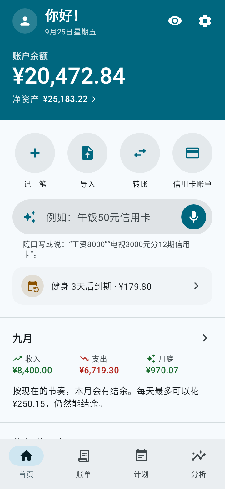
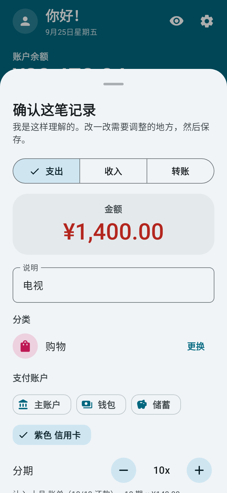
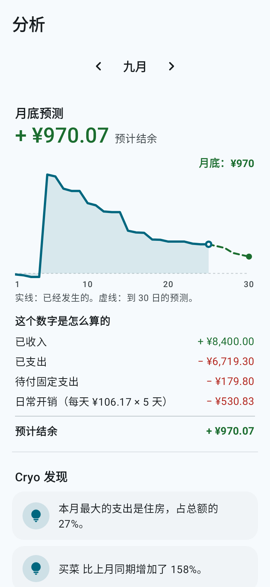
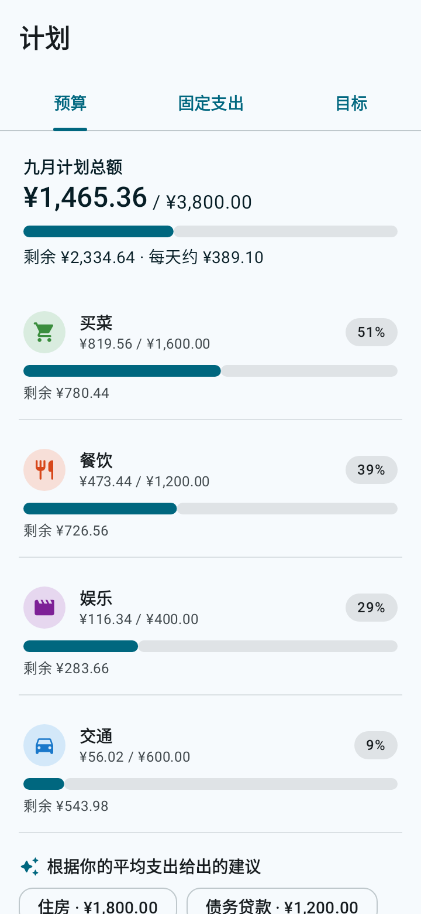
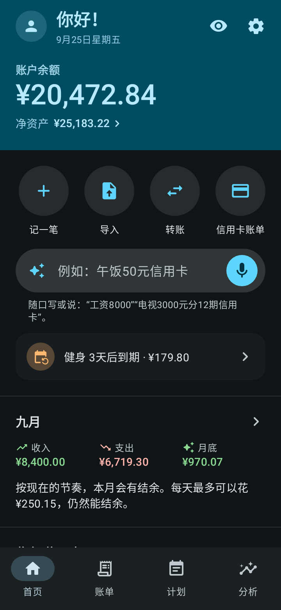

<p align="center">
  
</p>

<h1 align="center">Cryo</h1>

<p align="center"><b>你的钱，像冰一样清清楚楚。</b><br>
一款 Android 个人记账应用：简单好用、功能完整、离线使用、开源。</p>

<p align="center">
  <a href="../../README.md">English</a> ·
  <a href="README.pt-BR.md">Português</a> ·
  <a href="README.es.md">Español</a> ·
  <a href="README.fr.md">Français</a> ·
  <a href="README.de.md">Deutsch</a> ·
  <a href="README.it.md">Italiano</a> ·
  <a href="README.ja.md">日本語</a> ·
  <a href="README.ko.md">한국어</a> ·
  <b>中文</b> ·
  <a href="README.hi.md">हिन्दी</a>
</p>

<p align="center">
  
  
  
  
  
</p>

## 它能做什么

- **用一句话或语音记账。** 写下或说出“午饭 35”或“电视 1400 分10期 信用卡”。Cryo 能听懂金额、分类、账户、日期和分期数。你只需确认并保存。
- **月底预测。** 按现在的花钱速度，看看月底大概还剩多少，以及每天还能花多少。
- **消费日历和资金流向。** 看看哪些天花得最多，钱从哪里来、花到哪里去。
- **导入银行流水。** 支持 OFX、CSV、表格（XLSX）和 PDF：导入前先核对列表，自动建议分类，已经在 Cryo 里的记录不勾选，还能识别信用卡还款。
- **信用卡。** 账单、可用额度和分期消费，每一期都记到正确的账单里。
- **债务。** 贷款、分期合同、协议和欠别人的钱，与其他账目分开：还剩多少、逾期的期数、收入中有多少用来还款，以及什么时候能还清。
- **规划。** 带提醒的固定支出、按分类的预算，以及会建议每月存多少的储蓄目标。
- **投资和账户间转账。**
- **10 种语言和你的货币。** 中文、英语、葡萄牙语、西班牙语、法语、德语、意大利语、日语、韩语和印地语，货币也可以自选（人民币、美元、欧元、英镑、日元、韩元、卢比、雷亚尔等）。一句话记账和导入流水在所有语言中都能用。
- **动画使用导览**：第一次打开时介绍怎么用（之后也可以随时在设置里再看）。
- **Material You**、浅色和深色主题，以及顺滑的动画（遵循手机的“移除动画”设置）。

## 隐私

- 数据只保存在你的手机上。**这个应用没有联网权限。**
- 无需注册，没有广告，没有追踪。
- 可用指纹、面部或手机锁屏密码加锁。
- **自动备份** 到手机里的文件夹或你的云盘（Google 云端硬盘、Nextcloud 等），每天、每周或每月一次。Cryo 通过 Android 的文件选择器写入文件，上传由云盘应用完成。
- 随时可以备份成 `.json` 文件，或导出为 `.csv` 表格。

语音记账使用手机上已经安装的语音识别。输入文字的方式始终可用。

## 安装

- **F-Droid:** [f-droid.org/packages/io.github.h3yk0.cryo](https://f-droid.org/packages/io.github.h3yk0.cryo/)
- **GitHub:** 在 [Releases](https://github.com/H3yK0/cryo/releases) 页面下载 `Cryo-<版本>.apk`。

两者是同一个文件，用同一个密钥签名：F-Droid 会自己重新编译代码，只有结果与这里的 APK 完全相同时才会发布（可复现构建）。所以无需卸载，从哪边更新都可以。

## 从源代码构建

需要：JDK 21 和 Android SDK（平台 36）。发布的 APK 使用与 F-Droid 相同的 JDK 21 构建。

```bash
./gradlew assembleRelease     # 未签名的 APK 在 app/build/outputs/apk/release/
./gradlew testDebugUnitTest   # 自动化测试（规则、数据库、备份、导入和界面）
```

如果要用你自己的密钥签名，请创建 `keystore/keystore.properties`，写入 `storeFile`、`storePassword`、`keyAlias` 和 `keyPassword`。`keystore/` 文件夹永远不会进入代码仓库。

重新生成 F-Droid 页面和这些 README 的截图（`fastlane/` 文件夹），共 10 种语言：

```bash
./gradlew testDebugUnitTest --tests '*StoreScreenshotsTest' --tests '*StoreAssetsTest' -PstoreAssets=true
```

### 代码结构

| 文件夹 | 内容 |
|---|---|
| `domain/` | 不依赖 Android 的规则：余额、账单和分期、债务、预测、资金流向、语句解析（`PhraseParser.kt`、`PhraseLang.kt`）、语言和货币 |
| `importer/` | 读取流水（OFX、CSV、XLSX、PDF 和测试用 JSON）以及导入前的核对 |
| `data/` | 数据库（Room）、设置、备份、默认分类和示例数据 |
| `ui/` | 使用 Jetpack Compose 和 Material 3 的界面 |
| `notify/` | 固定支出和债务还款提醒（WorkManager） |

项目文档（[docs/PRD.md](../PRD.md) 中的需求、视觉指南、流水导入）使用作者的语言葡萄牙语编写。

## 参与贡献

欢迎在 [Issues](https://github.com/H3yK0/cryo/issues) 提出建议和报告问题，10 种语言都可以。

- **翻译：** 这 9 种翻译是在 AI 的帮助下完成的。如果你会说其中某种语言并发现不自然的地方，请提交 issue：非常欢迎母语者帮忙审校。
- **你银行的流水：** 应用有 **开发者模式**（在 设置 › 关于 中连续点 7 次版本号），包括使用独立数据库和示例数据的测试模式、各种格式的示例流水，以及可以分享匿名版本的读取报告。如果你银行的流水读得不对，可以在不发送个人数据的情况下帮忙：请看 [docs/IMPORTACAO.md](../IMPORTACAO.md#ajudar-a-melhorar-a-leitura)（葡萄牙语）。

## 许可证

Copyright © 2026 Hanry Franco

本程序是自由软件：你可以依据自由软件基金会发布的 [GNU Affero 通用公共许可证](../../LICENSE) 第 3 版，或（由你选择）任何更新的版本，重新分发和/或修改它。在 1.3 版之前，Cryo 以 GNU 通用公共许可证 v3 或更新版本发布。发布本程序是希望它有用，但 **不提供任何担保**。许可证的正式文本以英文原文为准。
